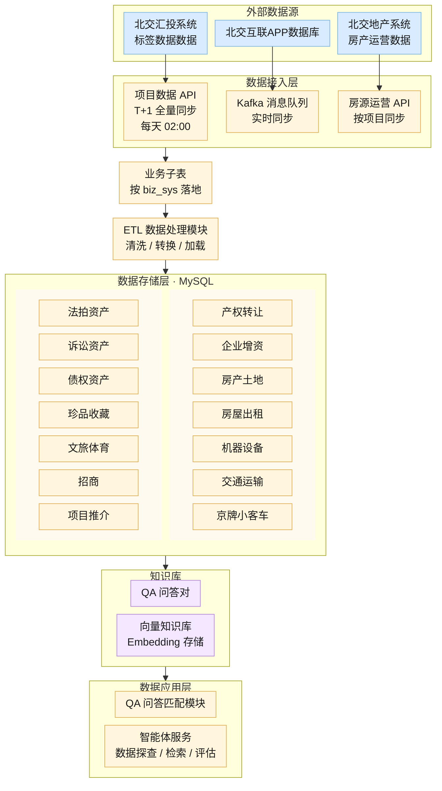

# 数据源结构

分层关系按当前 ETL 实现绘制，存储层大类取自《快捷入口名词》第一列。改节点文字、连线或下表即可，两处请一起改。

每个数据源只向下连自己的接入方式，线是直的。北交互联 APP 数据库经 Kafka 实时同步进入后面的处理。北交地产的 Kafka 监听仍停在 `scripts/scheduler.py` 的注释里，topic `BJDC_FYXXYYTZ` 的配置还在，这条不画进图里。

知识库、QA 匹配和智能体服务沿用目标架构。本仓库目前只把主表导出并上传知识库，没有单独的 QA 问答库和向量库实现。

## 结构图

## 存储大类

大类名称用第一列。业务范围摘自第二列，便于改分类时对照。落表是本仓库现在的主表，没有独立主表的大类先空着。

| 大类 | 业务数据范围 | 本仓库当前落表 |
| --- | --- | --- |
| 产权转让 | 产权转让项目；信息披露-正式披露-产权转让 | `equity_transfer`。子表 `bjhl_property_transfer`、`bjht_equity_transfer`；信息披露项目类型「股权转让」 |
| 企业增资 | 企业增资项目；正式披露 / 预披露-企业增资 | `equity_increase`。子表 `bjhl_enterprise_increase`、`bjht_equity_increase`；信息披露项目类型「股权增资」 |
| 房产土地 | 大宗实物-房屋建筑物、土地、在建工程；诉讼资产与司法拍卖中的住宅、商业、工业、其他用房、土地、车位；小宗实物-房屋建筑物、土地 | `property_land` 接收土地、房屋建筑物，子表 `bjht_real_estate_transfer`、`bjhl_bulk`。在建工程当前进入 `other_assets` |
| 房屋出租 | 房屋出租项目 | `property_rental`。子表 `bjht_house_rent`、`bjhl_house_rent`、`bjdc_lease_house`；信息披露项目类型「房屋出租」 |
| 机器设备 | 大宗实物-机械设备、存货、其他、技术类无形资产；小宗实物中的设备、家具、仪器仪表及其他 | `other_assets`。`bjhl_bulk` 资产类型：机械设备、存货、技术类无形资产、其他 |
| 交通运输 | 大宗 / 小宗交通运输工具与设备；机动车；司法拍卖与诉讼资产中的机动车、船舶、航空交通、交通工具 | `other_assets`。`bjhl_bulk` 资产类型：交通运输工具 |
| 京牌小客车 | 京牌小客车项目 | 无独立主表 |
| 法拍资产 | 司法拍卖各类项目 | 无独立主表 |
| 诉讼资产 | 诉讼资产各类项目 | 无独立主表 |
| 债权资产 | 大宗债权资产；正式披露 / 预披露-金融债权 | `debt_assets`。子表 `bjht_credit_asset`；`bjhl_bulk` 资产类型「债权」；信息披露项目类型「债权资产」 |
| 珍品收藏 | 珍品项目；司法拍卖 / 诉讼资产-珍品 | 无独立主表 |
| 文旅体育 | 信息披露中含「文旅」标签的项目；正式披露 / 预披露-体育 | `culture_tourism_sports`。信息披露项目类型「文旅体育」 |
| 招商 | 信息披露-招商 | 信息披露项目类型「其他招商」当前进入 `other_assets`。仓库中没有 `other_investment` |
| 项目推介 | 信息披露-项目推介（项目推介、投资意向） | 无独立主表 |

## 接入与子表

| 来源 | 接入 | 同步方式 | 落地子表 |
| --- | --- | --- | --- |
| 北交汇投系统 | 项目数据 API | T+1 全量。每天 02:00 先清空再写入，`is_full=1` | `bjhl_property_transfer` 互联股权；`bjht_equity_transfer` 汇投股权；`bjhl_info_disclosure` 互联信息披露；`bjhl_enterprise_increase` 互联企业增资；`bjht_equity_increase` 汇投增资；`bjht_real_estate_transfer` 汇投房产转让；`bjhl_bulk` 互联大宗；`bjht_credit_asset` 汇投债权；`bjht_house_rent` 汇投房屋出租；`bjhl_house_rent` 互联房屋出租 |
| 北交地产系统 | 房源运营 API | 按项目拉取运营信息 | `bjdc_lease_house` |
| 北交地产系统 | Kafka `BJDC_FYXXYYTZ` | 实时增量。调度未启用 | 启用后与房源运营同一套处理 |
| 北交互联 APP 数据库 | Kafka 消息队列 | 实时同步 | 进入业务子表后，与其他来源一起走 ETL |

主表由子表经 `MainTableETLProcessor` 按字段映射汇总。汇总完成后，`KnowledgeBaseManager` 按主表导出并上传知识库。
