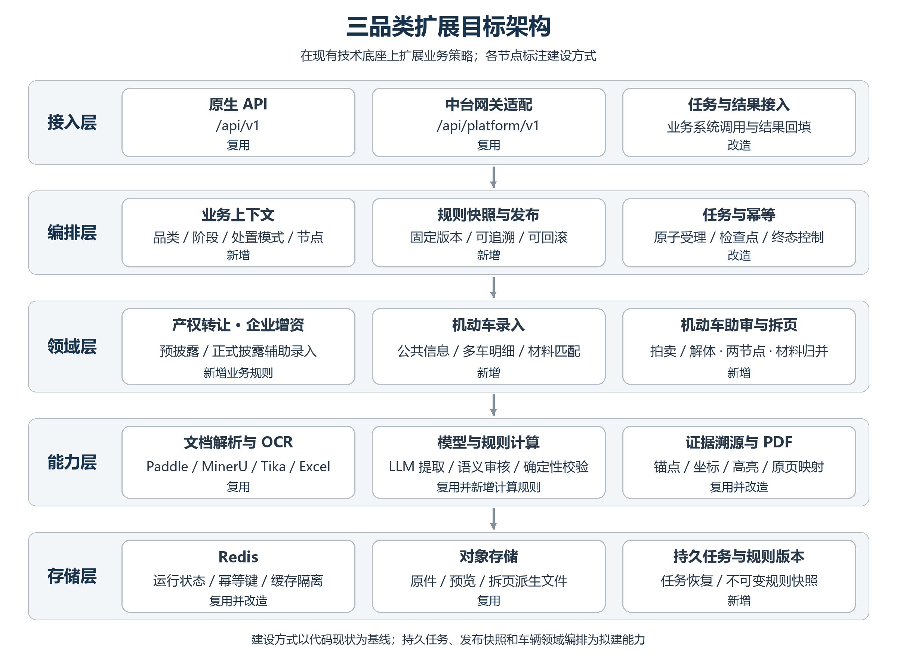
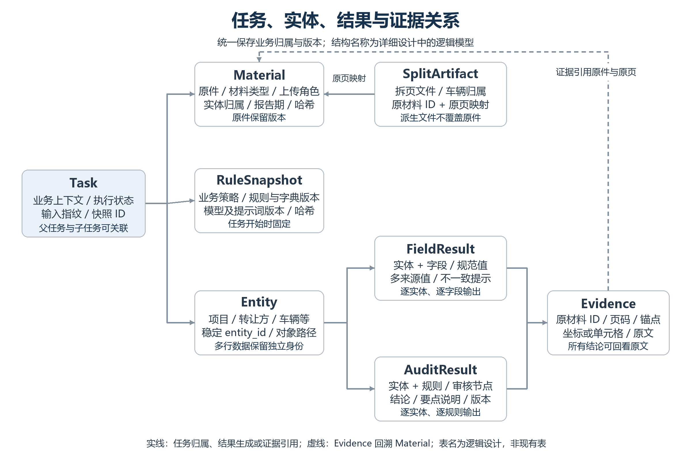

# 北交所录入助审系统业务品类扩展概要设计

产权转让 企业增资 机动车

版本 V1.0  评审版

编制日期 2026年11月4日

本设计在现有录入助审系统上扩展三类业务。产权转让和企业增资按预披露、正式披露分别配置辅助录入能力；机动车按有纸业务建设批量任务单录入及拍卖、解体两种助审流程。采用共用解析、提取、溯源与任务设施，加设业务策略、车辆实体编排和规则快照，保留既有四类实物接口的调用方式。

本文供业务负责人、架构师、项目经理和实施团队评审建设边界、总体架构、接口变化与实施顺序。配套详细设计定义内部模型、算法、状态、异常和验收用例。所有新增路径、编码和字段均为设计约定，发布前按评审结论冻结。

## 1 设计依据与建设边界

### 1.1 依据与优先关系

| 编号 | 依据 | 用途 |
| --- | --- | --- |
| S1 | 产权转让、企业增资、机动车.rtf | 业务功能和非功能基线；引用使用原章节号 |
| S2 | 北交所人工智能中台二期项目API接口说明文档 2026年10月30日 | 录入助审API基线；聚焦第一章第1节 |
| S3 | 项目代码 提交4c67c5474191dada9e93026ecced46a037ab9097 | 已实现能力、模型限制和改造位置 |
| S4 | docs/development/产权与增资业务扩展开发计划.md | 补充既有扩展思路；其扩展范围不自动替代本次需规 |

需求范围以S1为准；接口以S2与代码交叉核对，差异单独治理；现状判断以S3为准。S4提出产权、增资审核扩展，但S1本次仅定义其辅助录入，因此产权、增资自动助审作为后续可选扩展。S2第二部分的一句话找项目不纳入本次建设。

### 1.2 业务范围

| 场景 | 辅助录入 | 自动助审 | 主要处理对象 |
| --- | --- | --- | --- |
| 产权转让 预披露 | 本期 | 后续可选 | 产权转让信息预披露申请书 |
| 产权转让 正式披露 | 本期 | 后续可选 | 产权转让信息披露申请书 |
| 企业增资 预披露 | 本期 | 后续可选 | 企业增资信息预披露申请书 |
| 企业增资 正式披露 | 本期 | 后续可选 | 企业增资信息披露申请书 |
| 机动车 有纸 拍卖 | 本期 | 本期 | 一条任务公共信息 多辆车 两阶段附件 |
| 机动车 有纸 解体 | 本期 | 本期 | 一条任务公共信息 多辆车 两阶段附件 |
| 既有四类实物 | 兼容回归 | 兼容回归 | 原业务和规则 |

智能体输出录入建议、审核结论与证据；业务系统负责表单回填、人工确认、任务单提交、派发、退回和业务审批。通过智能助审不直接推动业务审批状态。机动车不扩展无纸业务，拍卖与解体属于处置模式，不套用实物的大宗、小宗维度。

### 1.3 业务流程边界

产权、增资采用“选择业务及披露阶段 → 上传相应申请书 → 解析与内容类型校验 → 规则及语义提取 → 业务经办核实回填 → 现有审批流程”。预披露和正式披露是独立录入场景，正式披露不默认继承预披露提取结果。

机动车采用“选择拍卖或解体 → 经办批量上传 → 附件匹配和质量检测 → 提取公共信息与车辆明细 → 人工补充确认 → 业务系统派发 → 服务机构录入及补传材料 → 助审节点1 → 补充项目及竞价等信息 → 助审节点2 → 人工逐级审批”。需规流程图中，经理和交易审核部查看节点2结果；修改字段或附件后应重新助审，旧结果保留版本。

S1企业增资流程图正式披露区域的绿色框仍标注“预披露辅助录入”，本设计按正文一.4.5.2采用正式披露。流程图中的人工审核节点不据此扩大为产权、增资智能助审。

## 2 现有系统与差距

### 2.1 可复用能力

现有系统使用Python、FastAPI、Pydantic，提供质量检测、文件分类、同步等待式字段提取与审核、任务查询与取消、规则配置及预览。文档处理集成Paddle、MinerU、Tika及Gotenberg，提取结果可附带页码、坐标和图片；规则配置保存在data/rule_configs的JSON文件，任务及缓存使用Redis并有本地回退路径。实际部署启用哪些解析器取决于配置。

平台网关负责中台请求头解码、材料类型映射和响应适配。业务扩展应同时覆盖原生API与平台网关，避免仅修改直接调用路径。

### 2.2 差距与建设动作

| 现状 | 影响 | 本次设计 |
| --- | --- | --- |
| 业务枚举仅四类实物 | 新业务无法按需选规则 | 增加四个产权增资类型及机动车有纸类型 |
| 类型分类不能证明披露阶段 | 错场景材料仍可能进入提取 | 增设内容识别和业务阶段校验 |
| 提取结果缓存主要按附件内容哈希 | 跨业务和规则串用 | 业务结果缓存隔离 配置先校验 |
| 字段为平铺结果 部分转换只取数组首项 | 多车丢失或同名字段覆盖 | 机动车公共信息与实体数组独立建模 |
| 同类型材料合并 审核有单值覆盖路径 | 不同车辆或来源混淆 | 文件身份 车辆归属 来源版本贯穿链路 |
| 后台任务依赖应用进程 无可靠持久队列 | 重启中断和单点影响 | 增设任务队列 认领租约与恢复 |
| 规则缺少不可变发布快照 | 执行中编辑影响可复现性 | 规则 提示词 映射与级联统一快照 |
| 缺少车辆拆页及多模态资产判断专用编排 | 不能直接满足机动车需规 | 增设实体索引 拆页清单 图像审核 |

源码定位见详细设计附录。README和历史设计中提及的能力不能代替实际路由与服务实现的核验。

## 3 总体架构

### 3.1 分层方案

接入层沿用原生API与中台适配。编排层解析业务上下文、固定规则快照、执行幂等与任务生命周期。领域层设置产权增资录入策略及机动车录入、审核、归并、拆页策略。基础能力层复用文档解析、模型调用、来源定位、PDF处理、缓存与对象存储。

业务策略通过注册表选择，不按品类复制整套服务。原生API和网关均调用同一编排入口。模型接入封装在现有客户端适配层后，提示词和结构化输出契约固定，模型替换需要回归同一业务样本集。

### 3.2 核心模块

| 模块 | 职责 | 交付方式 |
| --- | --- | --- |
| BusinessContextResolver | 解析业务 阶段 处置模式 审核节点 | 新增共享入口 |
| RuleSnapshotService | 校验类型和启用状态 固定规则内容指纹 | 扩展现有规则服务 |
| MaterialRecognitionService | 材料分类 业务识别 阶段识别 | 扩展分类 加识别证据 |
| DocumentPipeline | 原文解析 标准化锚点 溯源 | 复用并补全Word转换坐标关系 |
| DisclosureExtractionStrategy | 四种申请书字段和语义分组提取 | 新增策略及四套配置 |
| VehicleExtractionStrategy | 公共信息 逐车字段 数量和号牌校验 | 新增领域服务 |
| VehicleMaterialMerger | 经办与机构材料归并 全量留痕 | 新增领域服务 |
| VehicleAuditStrategy | 节点规则 四态判定 图像审核 | 新增领域服务 |
| VehicleDocumentSplitter | 用户触发按页拆分 输出文件及映射 | 新增领域服务 |
| TaskRepository Worker | 任务持久化 队列认领 取消与恢复 | 加固现有TaskStore |

### 3.3 关键架构决策

一是共用技术底座、分开领域模型。产权、增资保持平铺字段兼容，机动车返回common_fields与vehicles，避免把车辆数组塞进首条字段转换路径。

二是规则先于结果缓存解析。请求进入后先校验业务和规则，形成不可变快照，再查询带业务、场景和版本指纹的结果缓存；内容级解析缓存可以共享，业务结果不得仅凭文件哈希共享。

三是内容校验先于辅助录入。四种产权增资申请书须根据正文判定业务及阶段，不以文件名或调用方的file_type作为结论。明确不一致时终止，无法识别时给出补充材料提示。

四是长任务与短请求分离。保留已有同步等待与超时返回pending模式；机动车采用异步任务接口，接收后返回任务号，阶段进度和结果通过查询取得。新队列、Worker和持久化是拟建设能力。

五是任务完成与业务通过分离。任务completed表示处理结束；result_status区分success、partial、failed；审核四态单独统计。文件缺失、提取失败或证据不充分按规则输出待确认，不自动通过。

## 4 业务功能设计

### 4.1 产权转让与企业增资

新增四个对外业务值：产权转让-预披露、产权转让-正式披露、企业增资-预披露、企业增资-正式披露。继续使用extraction_type和rule_config_id，四种业务各发布一套独立规则，字段、条件分支和提示词按阶段配置。

每种申请书先解析正文与表格，再按内容校验业务类型和披露阶段；字段名明确且布局稳定的内容优先规则定位，长文本判断通过模型按关联字段分组提取。每个输出字段带原始值、标准值、提取状态、置信度及来源。批准信息等条件字段采用“判断前提 → 提取关联信息 → 校验依赖”的顺序；正文未提供的值留空并说明。

四场景的完整字段编码、必填性、枚举和表格明细结构通过规则清单评审冻结；需规给出的批准单位、批准日期、公告期满安排等作为首批规则样例，不将候选字段推定为全部必填字段。

### 4.2 机动车批量录入

一次任务生成一份任务公共信息和多份车辆信息。公共字段包含转让方、地址、审批单位、任务接收方归属等需规示例；车辆字段包含号牌、品牌、型号、审批原值等。材料清单按拍卖、解体和主体性质配置，支持申请表/委托书等替代材料关系。

从指定必传材料建立车辆基准集合，以号牌为业务比对标识，对其他材料按文件、页和车辆统计：原始行数、有效号牌数、去重车辆数、缺失号牌、重复号牌、额外车辆和无法归属的页。号牌缺失或重复时保留原记录并进入待确认，不通过猜测合并车辆。

字段来源按规则优先级选取录入建议，同时返回所有来源及不一致提示。用户勾选拆页后，对可明确提取号牌的多车PDF按页生成附件，文件名带号牌与页码，保留原文件到派生文件的映射；无法归属的页单独输出待确认清单。

### 4.3 机动车助审

助审接收业务系统确认字段、经办原附件和服务机构补传附件。归并对单方材料取并集；已确认同名同类型且内容相同或足以判定替代的材料优先采用机构版本，归并清单保留被替代文件和原因。不同车辆、不同版本或内容存在争议的附件不可只按名称静默覆盖。

审核节点1对应机构提交后的经办核实；节点2对应提交经理时的项目或解体信息审核，业务系统使用不同trigger_type触发，规则按处置模式及节点选择。节点2结果供后续审核人员查看，重新触发生成新运行版本。

审核覆盖同字段跨文件比对、字段内容的或/且逻辑、图像资产类型与号牌比对、字段间数值约束。使用通过、不通过、待确认、无需审核四类结果，并提供需规要求的解释和证据。多车材料先按车辆归属分组，再在同一车辆内完成跨来源两两比对，避免把不同车辆的号牌差异判为错误。

## 5 数据与接口概要

### 5.1 主要信息对象

任务记录调用方、业务场景、输入指纹、运行版本和规则快照；材料记录原始文件、上传角色、车辆归属和内容哈希；解析结果记录页、锚点和坐标；字段结果记录实体、字段、规范值与来源；审核结果引用规则、实体和证据；拆页结果引用原页及派生文件。

JSON规则保留为编制输入，发布后写入不可变快照。新增任务持久化与队列采用独立命名空间；任务业务结果与审计日志采用不同保留策略，现有任务90天清理不能承担需规180天审计要求。最终数据库与高可用部署选型按交易所平台标准评审确定。

### 5.2 对外接口策略

| 接口族 | 方案 | 兼容要求 |
| --- | --- | --- |
| 质量 分类 预览 | 复用原接口 | 扩展材料字典 不改原值 |
| 产权增资录入 | 复用extraction/sync和task/{task_id} | 新增四类型 返回仍为results字段列表 |
| 机动车录入 | 新增vehicle任务接口 | 异步创建 公共字段与逐车数组 |
| 机动车助审 | 新增vehicle审核任务接口 | 输入确认字段 材料来源 处置模式 节点 |
| 机动车附件匹配及结果 | 新增匹配与结果查询 | 未就绪返回业务未完成状态 |
| 机动车拆页 | 新增用户触发接口 | 绑定父任务和规则快照 |
| 任务取消 | 复用并扩展作用域 | 取消可终结 故障重试不覆盖终态 |

S2第一章录入助审接口使用数值code=200的原生外壳，原生路径为/api/v1。仓库src/platform_gw提供中台适配，默认路径为/api/platform/v1，Body保持原生格式并增加提供方业务响应头。详细设计分别列出两层契约，新功能中台服务编码在联调时注册。结果查询与附件匹配查询可以读取同一任务快照，满足需规的独立查询职责。

## 6 运行与非功能设计

### 6.1 性能与资源

S1要求30用户并发、平均响应小于3秒、事务成功率100%、CPU/内存/磁盘I/O均小于80%，并要求模型prefill小于2秒、decode不低于15 token/s。长文档完整处理无法直接由3秒请求指标推导达标，测试须分别测创建、查询、首次进度、全流程耗时和模型吞吐；指标含义由性能评审统一，保留需规要求，不能以异步接收成功替代处理成功。

按文件数、页数、车辆数、扫描比例和模型token量建立基准集，限制单任务页数和Worker并发，对OCR、LLM、拆页分别限流。控制参数由压测确定，并返回明确的超限或过载错误。

### 6.2 可用性与恢复

S1要求99.99%可用、零单点与7×24响应。拟采用网关/API多副本、持久队列、Worker多副本、Redis高可用、对象存储冗余以及解析/模型服务的冗余和熔断。仅增加API副本不足以实现该指标，所有依赖需纳入可用性边界和演练。

Worker以租约认领任务，按阶段持久化检查点；进程退出后租约超时可重新认领。最终结果采用版本校验和原子提交，取消、超时和成功竞争时只接受一次合法终态。原文件不覆盖，派生文件可按任务清理。

### 6.3 安全与审计

调用方身份由中台认证体系提供，服务端将任务与调用方、项目权限绑定，任务号本身不作为访问授权。下载地址、预览地址与拆页文件执行相同权限检查；外部URL设置允许名单、禁止私网探测及重定向绕过，限制大小与格式，解析文件在隔离服务中执行。

提示词中的文档正文作为数据处理，不能改变系统指令、调用工具或泄露其他项目内容。规则发布、模型替换、任务创建、人工更正、取消、查看及导出记录审计信息，审计保留180天并采取只追加、独立权限及备份。敏感数据加密和国密适配按交易所统一方案落地；等保相关要求以S1和平台测评口径实施。

S1引用的兼容性、风险版本、漏洞、等保附件进入上线检查基线；Java开发规范在本Python项目中转换为适用的编码和检查项，不据此改写现有技术栈。

## 7 实施和交付

| 阶段 | 内容 | 出口条件 |
| --- | --- | --- |
| P0 业务与接口基线 | 字段表 材料替代组 两节点规则 中台编码 样本与性能口径 | 业务和接口评审通过 |
| P1 共性能力 | 业务上下文 快照 内容校验 缓存隔离 结构化错误 队列恢复 | 新旧业务隔离及异常测试通过 |
| P2 产权增资 | 四场景提取配置 条件字段 证据与回填适配 | 四类正确与错配样本验收 |
| P3 机动车录入 | 多车模型 材料匹配 数量/号牌校验 拆页 | 多车无丢失 拆页全量对账 |
| P4 机动车助审 | 归并 两节点规则 四态 多模态证据 | 拍卖与解体业务用例通过 |
| P5 联调与投产 | 中台适配 30并发压测 安全和故障演练 灰度回滚 | 关键缺陷清零 验收记录齐全 |

交付包括规则与材料清单、API契约、模型和提示词版本、部署配置、验收样本及标准答案、迁移/回滚脚本和操作说明。工期以字段及规则规模、图像审核模型可用性和联调条件评估，不直接套用既有仅产权增资草案中的估算。

灰度通过业务策略开关分别启用四个披露场景及两种机动车处置模式。回滚时停止新任务、处理或取消在途任务，恢复旧策略和规则快照；新任务与新缓存命名空间保留，旧版本不得读取不兼容的新结果。

## 8 评审事项与验收重点

| 编号 | 需要冻结的内容 | 责任方 | 对设计的影响 |
| --- | --- | --- | --- |
| D01 | 四场景完整字段名 编码 枚举 条件与多行表格范围 | 业务方 | 四套规则及表单映射 |
| D02 | 机动车主体性质 处置模式 必传及替代组 | 业务方 | 材料校验与车辆基准 |
| D03 | 两节点字段/规则范围 号牌异常和归并判定细则 | 业务方 | 节点策略及待确认口径 |
| D04 | 机动车和材料中台编码 新接口注册 四态展示 | 接口及前端团队 | 网关与页面适配 |
| D05 | 图像模型部署 Word模板字体 预览保存期限 | 平台及运维 | 证据质量与可用性 |
| D06 | 3秒指标事务范围 SLA边界 恢复目标和容量 | 业务 测试 运维 | 压测与高可用验收 |

验收应证明：四个申请书场景不串规则，错业务/错阶段被阻止；批量车辆无首条截断和同类型覆盖；数量与号牌差异能定位到文件及页；机构归并可追溯；拆页无漏页且仅由用户触发；助审四态及两节点规则正确；取消、重试、并发与缓存不破坏结果隔离；原四类实物回归通过。
