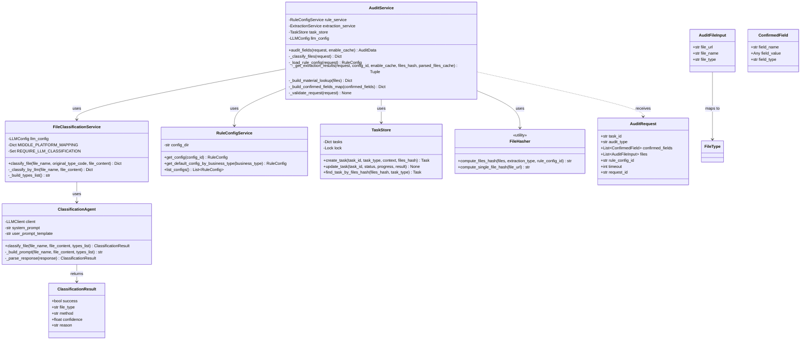
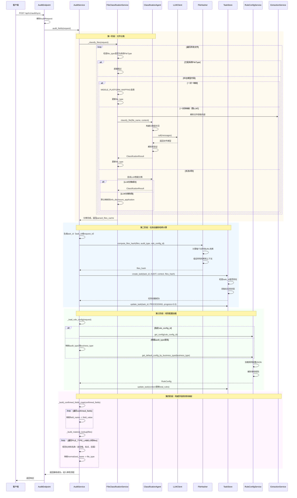

# 2.3.11 审核-项目信息/附件接收子模块详细设计

## 2.3.11.1 类设计



### 类说明

1. **AuditService**：审核服务主类
   - 协调整个审核流程
   - 接收和校验项目信息
   - 管理文件分类和解析
   - 创建审核任务

2. **FileClassificationService**：文件分类服务
   - 将中台类型代码映射到系统FileType
   - 支持直接映射（一对一）
   - 支持LLM智能分类（一对多）
   - 维护映射表

3. **ClassificationAgent**：LLM分类代理
   - 基于文件名和内容智能分类
   - 处理无法直接映射的文件类型
   - 返回分类结果和置信度

4. **RuleConfigService**：规则配置服务
   - 加载审核规则配置
   - 支持根据业务类型查找默认配置
   - 支持指定规则配置ID

5. **TaskStore**：任务存储
   - 创建和管理审核任务
   - 追踪任务状态和进度
   - 支持基于files_hash的缓存查询

6. **FileHasher**：文件哈希工具
   - 计算附件哈希值
   - 用于缓存查找和去重
   - 基于文件URL、业务类型和规则ID

7. **AuditRequest**：审核请求模型
   - 包含所有审核所需信息
   - 支持Pydantic验证
   - 提供示例和文档

## 2.3.11.2 时序设计



### 时序说明

1. **文件分类阶段**：
   - 三级分类策略：系统FileType → 直接映射 → LLM智能分类
   - 直接映射使用MIDDLE_PLATFORM_MAPPING表
   - LLM分类需要解析文件获取内容
   - 失败降级：默认映射到info_disclosure_application

2. **任务创建和哈希计算**：
   - 生成task_id（优先使用传入的task_id，否则用request_id）
   - 计算files_hash用于缓存查询
   - 创建AUDIT类型任务
   - 更新任务状态为PROCESSING

3. **规则配置加载**：
   - 支持两种方式：指定rule_config_id或根据audit_type查找
   - audit_type通过mapper映射到business_type
   - 加载JSON配置文件并解析审核规则
   - 更新任务上下文（保存total_rules）

4. **字段和材料映射构建**：
   - 构建confirmed_fields_map：field_name -> field_value
   - 构建material_lookup：规范化材料名称 -> file_type
   - 规范化处理：去空格、标点、文件后缀、转小写

## 2.3.11.3 其他设计

**异常处理**

1. **请求校验异常**：
   - 缺少必填字段：返回400错误
   - 文件列表为空：返回400错误
   - audit_type不合法：返回400错误
   - 字段值类型错误：Pydantic自动验证

2. **文件分类异常**：
   - LLM分类失败：降级到默认分类
   - 文件解析失败：跳过LLM分类，使用默认分类
   - 分类结果无效：使用默认分类

3. **任务创建异常**：
   - task_id冲突：返回409错误
   - TaskStore异常：捕获并返回500错误

4. **规则配置异常**：
   - 配置不存在：返回404错误
   - JSON格式错误：返回500错误
   - 规则字段缺失：跳过该规则

**配置管理**

- **文件分类配置**：
  ```python
  # 中台类型到系统FileType的直接映射
  MIDDLE_PLATFORM_MAPPING = {
      "NBJYHYQPZJGJCWJ": FileType.INTERNAL_DECISION,
      "ZCPGBGSHQTDJWJ": FileType.EVALUATION_REPORT,
      "PGBGDHZHBACL": FileType.EVALUATION_FILING,
      "FWCQZS": FileType.PROPERTY_CERTIFICATE,
      "TDCQZS": FileType.LAND_USE_CERTIFICATE,
      "ZCQD": FileType.ASSET_LIST,
      "TKCNS": FileType.INSPECTION_COMMITMENT,
  }
  
  # 需要LLM智能分类的类型
  REQUIRE_LLM_CLASSIFICATION = {"QTWJ"}
  ```

- **LLM分类Agent配置**：
  ```python
  CLASSIFICATION_AGENT = {
      "model_name": "qwen-max",
      "temperature": 0.1,
      "max_tokens": 500,
      "timeout": 30,
      "max_content_length": 10000,  # 限制文件内容长度
      "system_prompt": "...",
      "user_prompt_template": "..."
  }
  ```

- **任务配置**：
  ```python
  TASK_CONFIG = {
      "default_timeout": 1000,  # 默认超时时间（毫秒）
      "max_concurrent_tasks": 50,  # 最大并发任务数
      "task_ttl": 86400,           # 任务保留时间（秒）
  }
  ```

## 2.3.11.4 实现方式

**三级文件分类策略**

级别 | 策略 | 适用场景 | 置信度
-----|------|---------|-------
第一级 | 直接判断 | file_type已是系统FileType | 1.0
第二级 | 直接映射 | 中台类型代码一对一映射 | 1.0
第三级 | LLM智能分类 | 一对多关系或无法识别的类型 | 0.6-0.9

**实现逻辑**：

```python
async def _classify_files(request: AuditRequest) -> Dict[str, Any]:
    """
    对请求中的文件进行分类，将中台类型代码映射到系统FileType
    
    返回：parsed_files_cache，用于后续复用解析结果
    """
    parsed_files_cache = {}
    files_need_llm = []
    
    # 第一阶段：快速处理可直接映射的文件
    for file_input in request.files:
        original_type = file_input.file_type
        
        # 第一级：已是系统FileType
        try:
            FileType(original_type)
            logger.info(f"文件类型已是系统FileType: {original_type}")
            continue
        except ValueError:
            pass
        
        # 第二级：直接映射
        if original_type in MIDDLE_PLATFORM_MAPPING:
            mapped_type = MIDDLE_PLATFORM_MAPPING[original_type]
            file_input.file_type = mapped_type.value
            logger.info(f"直接映射: {original_type} -> {mapped_type.value}")
            continue
        
        # 需要LLM分类
        files_need_llm.append(file_input)
    
    # 第二阶段：批量解析需要LLM分类的文件
    if files_need_llm:
        # 批量解析文件内容
        parse_tasks = [
            extraction_service._parse_file(file_input)
            for file_input in files_need_llm
        ]
        parse_results = await asyncio.gather(*parse_tasks, return_exceptions=True)
        
        # 缓存解析结果
        for file_input, parse_result in zip(files_need_llm, parse_results):
            if not isinstance(parse_result, Exception):
                parsed_files_cache[file_input.file_url] = parse_result
        
        # 并行调用LLM分类
        classification_tasks = [
            classification_service.classify_file(
                file_name=file_input.file_name,
                original_type_code=file_input.file_type,
                file_content=parsed_files_cache.get(file_input.file_url, {}).get("md_content")
            )
            for file_input in files_need_llm
        ]
        
        classification_results = await asyncio.gather(*classification_tasks, return_exceptions=True)
        
        # 更新文件类型
        for file_input, result in zip(files_need_llm, classification_results):
            if not isinstance(result, Exception) and result.get("file_type"):
                file_input.file_type = result["file_type"]
                logger.info(f"LLM分类: {file_input.file_name} -> {result['file_type']}")
    
    return parsed_files_cache
```

**LLM智能分类**

当文件类型无法直接映射时，使用LLM基于文件名和内容进行智能分类：

```python
async def _classify_by_llm(file_name: str, file_content: str) -> Dict:
    """
    使用LLM智能分类文件
    
    策略：
    1. 构建可选类型列表（所有系统FileType）
    2. 限制文件内容长度（避免超出token限制）
    3. 调用LLM分类Agent
    4. 验证分类结果是否在有效范围内
    """
    # 构建类型列表
    types_list = "\n".join([
        f"- {file_type.value}: {FILE_TYPE_LABELS[file_type]}"
        for file_type in FileType
    ])
    
    # 限制内容长度
    max_length = 10000
    truncated_content = file_content[:max_length]
    if len(file_content) > max_length:
        truncated_content += "\n\n...(内容已截断)..."
    
    # 调用LLM Agent
    async with LLMClient(classification_config) as client:
        agent = ClassificationAgent(client)
        result = await agent.classify_file(
            file_name=file_name,
            file_content=truncated_content,
            types_list=types_list
        )
    
    # 验证结果
    if result.success:
        try:
            FileType(result.classified_file_type)
            return {
                "file_type": result.classified_file_type,
                "method": "llm_classification",
                "confidence": result.confidence,
                "reason": result.reason
            }
        except ValueError:
            logger.error(f"LLM返回无效文件类型: {result.classified_file_type}")
    
    # 失败降级
    return {
        "file_type": FileType.INFO_DISCLOSURE_APPLICATION.value,
        "method": "default",
        "confidence": 0.3,
        "reason": "LLM分类失败，使用默认分类"
    }
```

**Files Hash计算**

用于缓存查询和去重：

```python
def compute_files_hash(
    files: List[AuditFileInput],
    extraction_type: str,
    rule_config_id: Optional[str]
) -> str:
    """
    计算附件哈希值
    
    考虑因素：
    1. 所有文件的URL（顺序无关）
    2. 业务类型（extraction_type或audit_type）
    3. 规则配置ID
    
    算法：
    1. 计算每个文件URL的MD5
    2. 对所有文件哈希排序（消除顺序影响）
    3. 组合sorted_hashes + extraction_type + rule_config_id
    4. 计算最终SHA256哈希
    """
    import hashlib
    
    # 计算每个文件的哈希
    file_hashes = []
    for file_input in files:
        url_hash = hashlib.md5(file_input.file_url.encode()).hexdigest()
        file_hashes.append(url_hash)
    
    # 排序（消除顺序影响）
    file_hashes.sort()
    
    # 组合所有因素
    combined = "".join(file_hashes) + extraction_type + (rule_config_id or "")
    
    # 计算最终哈希
    return hashlib.sha256(combined.encode()).hexdigest()
```

**材料名称规范化**

用于材料名称到文件类型的匹配：

```python
def _normalize_material_name(name: Optional[str]) -> str:
    """
    规范化材料名称，便于匹配
    
    处理步骤：
    1. 转小写
    2. 去除空格、换行、引号、书名号
    3. 去除文件后缀（.pdf, .docx等）
    """
    if not name:
        return ""
    
    import re
    
    normalized = name.lower().strip()
    
    # 去除特殊符号
    normalized = re.sub(r"[《》\"'\s]", "", normalized)
    
    # 去除文件后缀
    normalized = re.sub(
        r"\.(pdf|docx|doc|txt|rtf|png|jpg|jpeg|bmp|tiff|webp)$",
        "",
        normalized
    )
    
    return normalized
```

**规则配置加载**

支持两种方式加载审核规则：

```python
async def _load_rule_config(request: AuditRequest) -> RuleConfig:
    """
    加载规则配置
    
    优先级：
    1. 指定rule_config_id
    2. 根据audit_type映射到business_type，加载默认配置
    """
    if request.rule_config_id:
        # 方式1：指定配置ID
        config = await rule_service.get_config(request.rule_config_id)
        if not config:
            raise ValueError(f"规则配置不存在: {request.rule_config_id}")
        return config
    
    # 方式2：根据audit_type查找默认配置
    business_type = map_extraction_type_to_business_type(request.audit_type)
    config = await rule_service.get_default_config_by_business_type(business_type)
    
    if not config:
        raise ValueError(f"未找到业务类型 {business_type} 的默认规则配置")
    
    return config
```

**任务管理**

创建和追踪审核任务：

```python
async def create_and_track_task(
    task_id: str,
    audit_type: str,
    files_hash: str
) -> None:
    """
    创建审核任务并追踪进度
    
    流程：
    1. 创建任务（保存files_hash用于缓存查询）
    2. 更新状态为PROCESSING
    3. 保存审核上下文（audit_type, rule_config_id, total_rules）
    """
    # 创建任务
    await task_store.create_task(
        task_id=task_id,
        task_type=TaskType.AUDIT,
        context={
            "audit_type": audit_type,
            "rule_config_id": rule_config_id
        },
        files_hash=files_hash
    )
    
    # 更新状态
    await task_store.update_task(
        task_id,
        status=TaskStatus.PROCESSING,
        progress=0.0
    )
    
    # 加载规则配置后更新total_rules
    await task_store.update_task(
        task_id,
        context={
            "audit_type": audit_type,
            "rule_config_id": rule_config_id,
            "total_rules": len(config.audit_rules)
        }
    )
```

**请求校验**

使用Pydantic自动校验：

```python
class AuditRequest(BaseModel):
    """审核请求模型"""
    task_id: Optional[str] = None
    audit_type: str = Field(..., min_length=1)
    confirmed_fields: List[ConfirmedField] = Field(..., min_items=1)
    files: List[AuditFileInput] = Field(..., min_items=1)
    rule_config_id: Optional[str] = None
    timeout: Optional[int] = Field(default=1000, ge=1000)
    
    @validator("confirmed_fields")
    def validate_confirmed_fields(cls, v):
        if not v:
            raise ValueError("confirmed_fields不能为空")
        return v
    
    @validator("files")
    def validate_files(cls, v):
        if not v:
            raise ValueError("files不能为空")
        return v
```

**性能优化**

1. **批量处理**：
   - 批量解析需要LLM分类的文件
   - 并行调用LLM分类

2. **缓存复用**：
   - 分类阶段的解析结果缓存（parsed_files_cache）
   - 后续提取阶段复用，避免重复解析

3. **任务去重**：
   - 基于files_hash查找历史任务
   - 相同附件和配置直接返回缓存结果

4. **异步处理**：
   - 使用asyncio.gather并行处理
   - 提高文件分类和解析效率


