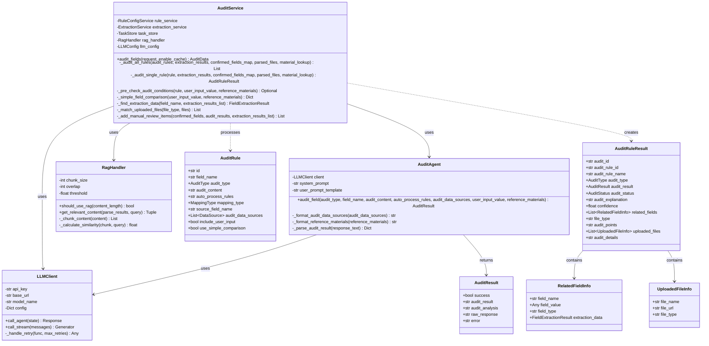

# 2.3.12 审核-文件/字段审核子模块详细设计

## 2.3.12.1 类设计



### 类说明

1. **AuditService**：审核服务主类
   - 协调整个审核流程
   - 管理规则并发执行
   - 构建审核数据源和参考材料
   - 预检查审核条件
   - 支持简单对比模式

2. **AuditAgent**：LLM审核代理
   - 封装LLM调用逻辑
   - 构建审核提示词
   - 解析LLM返回的JSON结果
   - 支持字段审核和文件审核

3. **LLMClient**：LLM客户端
   - 统一的LLM API调用接口
   - 支持重试和错误处理
   - 支持流式和非流式调用

4. **RagHandler**：RAG检索处理器
   - 检测文档内容是否过长
   - 检索最相关的内容片段
   - 优化超长文档审核

5. **AuditRule**：审核规则模型
   - 包含审核类型、内容、处理规则
   - 支持自动映射和自定义映射
   - 支持简单对比模式

6. **AuditRuleResult**：审核结果模型
   - 统一的审核结果格式
   - 区分字段审核和文件审核
   - 包含溯源信息

7. **RelatedFieldInfo**：关联字段信息
   - 用于字段审核结果
   - 包含用户输入和提取数据

8. **UploadedFileInfo**：已上传文件信息
   - 用于文件审核结果
   - 标记已上传的文件

## 2.3.12.2 时序设计

```mermaid
sequenceDiagram
    participant AS as AuditService
    participant ES as ExtractionService
    participant RAG as RagHandler
    participant AA as AuditAgent
    participant LLM as LLMClient
    participant TS as TaskStore
    
    AS->>AS: 获取提取结果（缓存或新提取）
    AS->>AS: 构建confirmed_fields_map
    AS->>AS: 构建material_lookup
    
    rect rgb(255, 250, 240)
        Note over AS,TS: 并发审核所有规则
        
        AS->>AS: _audit_all_rules(audit_rules)
        
        loop 遍历审核规则
            AS->>AS: 创建_audit_single_rule任务
        end
        
        AS->>AS: 使用信号量控制并发数（audit_workers）
        
        par 并发执行审核任务
            AS->>AS: _audit_single_rule(rule)
            
            rect rgb(240, 248, 255)
                Note over AS,RAG: 单个规则审核流程
                
                alt 字段审核（FIELD_AUDIT）
                    AS->>AS: 根据mapping_type构建数据源
                    
                    alt 自动映射（AUTO）
                        AS->>AS: 从extraction_results获取source_field_name
                    else 自定义映射（CUSTOM）
                        loop 遍历audit_data_sources
                            alt 字段值
                                AS->>AS: 从extraction_results获取
                            else 全文
                                AS->>AS: 从parsed_files获取md_content
                                
                                alt 内容过长
                                    AS->>RAG: should_use_rag(content_length)
                                    RAG-->>AS: true
                                    AS->>RAG: get_relevant_content(parse_results, query)
                                    RAG->>RAG: 分块和相似度计算
                                    RAG-->>AS: 相关内容片段
                                end
                            end
                        end
                    end
                    
                    AS->>AS: 获取user_input_value（如果include_user_input）
                    
                else 文件审核（FILE_AUDIT）
                    loop 遍历audit_data_sources
                        AS->>AS: 从parsed_files获取全文
                        
                        alt 内容过长
                            AS->>RAG: should_use_rag(content_length)
                            RAG-->>AS: true
                            AS->>RAG: get_relevant_content(parse_results, query)
                            RAG-->>AS: 相关内容片段
                        end
                    end
                end
                
                AS->>AS: _pre_check_audit_conditions(rule)
                
                alt 预检查失败
                    AS-->>AS: 返回PENDING结果，跳过LLM
                else 预检查通过
                    alt 使用简单对比模式
                        AS->>AS: _simple_field_comparison()
                        AS->>AS: 字符串对比（OCR容错）
                        AS-->>AS: 返回对比结果
                    else 使用LLM审核
                        AS->>AA: audit_field(...)
                        AA->>AA: 构建审核提示词
                        AA->>LLM: call_agent(state)
                        LLM-->>AA: JSON响应
                        AA->>AA: 解析审核结果
                        AA-->>AS: AuditResult
                        
                        alt 字段审核
                            AS->>AS: 构建RelatedFieldInfo
                            AS->>AS: 包含提取数据和溯源信息
                        else 文件审核
                            AS->>AS: 构建UploadedFileInfo
                            AS->>AS: 匹配已上传文件
                        end
                        
                        AS-->>AS: 返回AuditRuleResult
                    end
                end
            end
            
            AS->>TS: update_task(progress)
        end
    end
    
    AS->>AS: _add_manual_review_items()
    AS->>AS: 添加未被自动审核覆盖的字段
    
    AS->>AS: 统计结果（passed/failed/pending/manual_review）
    AS->>AS: 构建AuditData
    AS->>TS: update_task(COMPLETED, result)
```



### 时序说明

1. **准备阶段**：
   - 获取提取结果（复用缓存）
   - 构建confirmed_fields_map：field_name -> field_value
   - 构建material_lookup：规范化材料名称 -> file_type

2. **并发审核阶段**：
   - 使用信号量限制并发数（audit_workers，默认3）
   - 并发执行所有审核规则
   - 实时更新任务进度

3. **单个规则审核流程**：
   - **构建数据源**：
     - 字段审核：根据mapping_type（AUTO/CUSTOM）构建
     - 文件审核：从parsed_files获取全文
   - **RAG优化**：超长文档启用RAG检索相关片段
   - **预检查**：判断是否满足审核条件，不满足则跳过LLM
   - **审核模式**：
     - 简单对比模式：字符串对比（OCR容错）
     - LLM审核模式：调用LLM Agent
   - **结果封装**：
     - 字段审核：构建RelatedFieldInfo（包含提取数据）
     - 文件审核：构建UploadedFileInfo（匹配已上传文件）

4. **结果汇总阶段**：
   - 添加未被自动审核覆盖的字段（标记为人工审核）
   - 统计审核结果
   - 更新任务状态为完成

## 2.3.12.3 其他设计

**异常处理**

1. **LLM审核异常**：
   - 超时：重试3次，指数退避
   - 限流：捕获429错误，延迟重试
   - JSON解析失败：返回审核失败

2. **数据源缺失**：
   - 提取结果不存在：预检查返回PENDING
   - 全文内容为空：预检查返回PENDING
   - 用户输入为空：根据规则判断是否跳过

3. **RAG检索异常**：
   - 分块失败：降级使用完整内容
   - 相似度计算异常：使用默认分块

**配置管理**

- **AuditAgent配置**：
  ```python
  AUDIT_AGENT = {
      "model_name": "qwen-max",
      "temperature": 0.1,
      "max_tokens": 2000,
      "timeout": 60,
      "max_retries": 3,
      "system_prompt": "...",
      "user_prompt_template": "..."
  }
  
  CONCURRENCY = {
      "audit_workers": 3  # 审核并发数
  }
  ```

- **RAG配置**：
  ```python
  RAG_CONFIG = {
      "threshold": 30000,  # 触发RAG的内容长度阈值
      "chunk_size": 5000,  # 分块大小
      "overlap": 500,      # 重叠大小
      "top_k": 3          # 检索Top-K片段
  }
  ```

- **审核规则配置示例**：
  ```json
  {
      "id": "rule_001",
      "field_name": "坐落位置",
      "audit_type": "字段审核",
      "audit_content": "核实用户输入的坐落位置与不动产权证中的坐落位置是否一致",
      "auto_process_rules": "完全一致则通过；存在差异则不通过",
      "mapping_type": "AUTO",
      "source_field_name": "坐落位置",
      "include_user_input": true,
      "use_simple_comparison": false
  }
  ```

## 2.3.12.4 实现方式

**字段审核与文件审核的统一处理**

虽然字段审核和文件审核有不同的关注点，但本系统采用统一的LLM Agent进行处理：

类型 | 关注点 | 数据源构建 | 结果封装
-----|-------|-----------|--------
字段审核 | 用户输入与提取字段的一致性 | 提取字段值 + 用户输入 | RelatedFieldInfo（包含提取数据）
文件审核 | 文件内容是否满足审核要点 | 全文内容 | UploadedFileInfo（匹配已上传文件）

**LLM Agent审核流程**

1. **系统提示词**（参考用户提供的示例）：
   ```
   # 角色: AI规则审核专家
   
   ## 背景
   你是一个用于自动化审核流程的AI专家。你的任务是根据预设的审核规则，对用户
   输入和相关参考材料进行严谨、客观的评估。你需要模拟一位经验丰富的高级内容
   审核专家，不仅要准确执行规则，还要能够处理OCR识别错误等实际问题，并以
   结构化的JSON格式输出可追溯的审核结果。
   
   ## 核心技能
   - 精准规则解析与匹配
   - 上下文综合分析
   - 智能容错处理（OCR错误：标点符号、相似字符、空格）
   - 逻辑推理能力
   - 结构化输出
   
   ## 工作流程
   1. 任务识别：确认审核类型和审核字段
   2. 规则解析：理解审核内容的每一个要点
   3. 材料审查：
      - 字段审核：比对用户输入和参考材料中的相关信息
      - 文件审核：全面审查参考材料是否满足规则要求
   4. 执行审核：逐项比对，智能处理OCR容错
   5. 形成分析：整理比对过程和判断依据
   6. 结果判定：根据自动化处理规则确定最终结果
   7. 格式化输出：按照OutputFormat输出JSON
   
   ## OutputFormat (输出格式)
   {
       "审核字段": ["字段名"],
       "审核规则简述": "简要复述审核规则",
       "审核分析": "详细的审核分析过程",
       "审核结果": "通过/不通过/待确认"
   }
   ```

2. **用户提示词**（参考用户提供的示例）：
   ```python
   prompt = f"""
   请根据以下提供的审核任务信息，对内容进行审核。"审核结果"枚举值: "通过/不通过/待确认"
   
   **审核任务详情:**
   - **审核类型:** {audit_type}
   - **审核字段:** {field_name}
   - **审核规则 (`audit_content`):**
   {audit_content}
   - **自动化处理规则 (`auto_process_rules`):**
   {auto_process_rules}
   - **数据来源描述 (`audit_data_sources`):**
   {audit_data_sources}
   
   **待审核内容:**
   - **用户输入值/系统所填值 (`user_input`):**
   {user_input_key}
   - **参考材料 (`reference_materials`):**
   {reference_materials}
   
   请开始审核，并严格按照系统提示词中定义的`OutputFormat`输出结果，注意输出需要符合JSON格式。
   """
   ```

3. **响应解析**：
   ```python
   def _parse_audit_result(response_text: str) -> Dict:
       """
       解析LLM返回的审核结果
       
       策略：
       1. 提取JSON块（正则匹配```json...```或直接匹配{...}）
       2. 解析JSON
       3. 验证必需字段（审核字段、审核结果）
       """
       # 尝试提取JSON块
       json_match = re.search(r'```json\s*(\{.*?\})\s*```', response_text, re.DOTALL)
       if json_match:
           json_str = json_match.group(1)
       else:
           # 尝试直接匹配JSON
           json_match = re.search(r'\{.*\}', response_text, re.DOTALL)
           if json_match:
               json_str = json_match.group(0)
           else:
               return None
       
       # 解析JSON
       audit_data = json.loads(json_str)
       
       # 验证必需字段
       if "审核结果" not in audit_data:
           return None
       
       return audit_data
   ```

**数据源构建策略**

根据audit_type和mapping_type构建不同的数据源：

```python
async def _build_audit_data_sources(
    rule: AuditRule,
    extraction_results: Dict,
    confirmed_fields_map: Dict,
    parsed_files: Dict
) -> Tuple[List[str], Dict[str, Any], Optional[str]]:
    """
    构建审核数据源
    
    返回：
    - audit_data_sources: 数据源描述列表（用于LLM输入）
    - reference_materials: 实际参考材料内容（用于LLM输入）
    - user_input_value: 用户输入值（用于LLM输入）
    """
    audit_data_sources = []
    reference_materials = {}
    user_input_value = None
    
    if rule.audit_type == AuditType.FIELD_AUDIT:
        # 字段审核
        if rule.mapping_type == MappingType.AUTO:
            # 自动映射：从extraction_results根据source_field_name获取
            source_field_name = rule.source_field_name
            if source_field_name in extraction_results:
                field_data = extraction_results[source_field_name]
                for source_type, data in field_data.items():
                    file_name = data['source_file_name']
                    key = f"{file_name} - {source_field_name}"
                    audit_data_sources.append(key)
                    reference_materials[key] = data["value"]
        
        else:
            # 自定义映射：根据audit_data_sources配置获取
            for ds in rule.audit_data_sources:
                if ds.field_name:
                    # 字段值：从extraction_results获取
                    if ds.field_name in extraction_results:
                        field_data = extraction_results[ds.field_name]
                        for source_type, data in field_data.items():
                            key = f"{ds.material_name} - {ds.field_name}"
                            audit_data_sources.append(key)
                            reference_materials[key] = data["value"]
                else:
                    # 全文：从parsed_files获取
                    file_type = resolve_file_type(ds.material_name)
                    file_data = parsed_files.get(file_type)
                    if file_data:
                        md_content = file_data.get("md_content", "")
                        
                        # RAG优化
                        if rag_handler.should_use_rag(len(md_content)):
                            query = f"{rule.field_name} {rule.audit_content}"
                            md_content, _ = rag_handler.get_relevant_content(
                                file_data.get("parse_results", []), query
                            )
                        
                        key = f"{ds.material_name} - 全文"
                        audit_data_sources.append(key)
                        reference_materials[key] = md_content
        
        # 用户输入
        if rule.include_user_input and rule.field_name in confirmed_fields_map:
            user_input_value = confirmed_fields_map[rule.field_name]
            user_input_value = convert_field_value_to_string(user_input_value)
    
    else:
        # 文件审核：根据audit_data_sources获取全文
        for ds in rule.audit_data_sources:
            file_type = resolve_file_type(ds.material_name)
            file_data = parsed_files.get(file_type)
            if file_data:
                md_content = file_data.get("md_content", "")
                
                # RAG优化
                if rag_handler.should_use_rag(len(md_content)):
                    query = f"{rule.field_name} {rule.audit_content}"
                    md_content, _ = rag_handler.get_relevant_content(
                        file_data.get("parse_results", []), query
                    )
                
                key = f"{ds.material_name} - 全文"
                audit_data_sources.append(key)
                reference_materials[key] = md_content
    
    return audit_data_sources, reference_materials, user_input_value
```

**预检查机制**

在调用LLM之前，预检查审核条件，避免无效审核：

```python
def _pre_check_audit_conditions(
    rule: AuditRule,
    user_input_value: Optional[str],
    reference_materials: Dict[str, Any],
    extraction_results_list: List[FieldExtractionResult]
) -> Optional[AuditRuleResult]:
    """
    预检查审核条件
    
    返回：
    - None：满足审核条件，继续审核
    - AuditRuleResult：不满足审核条件，返回PENDING结果
    
    检查项：
    1. 字段审核需要用户输入
    2. 参考材料不能为空
    3. 提取结果存在且有值
    """
    # 1. 字段审核需要用户输入
    if rule.audit_type == AuditType.FIELD_AUDIT:
        if rule.include_user_input and not user_input_value:
            logger.warning(f"规则 {rule.field_name} 需要用户输入但未提供，跳过审核")
            extraction_data = find_extraction_data(rule.field_name, extraction_results_list)
            return AuditRuleResult(
                audit_id=f"audit_{uuid.uuid4().hex[:16]}",
                audit_rule_id=getattr(rule, 'id', None),
                audit_rule_name=rule.field_name,
                audit_type=AuditTypeEnum.FIELD_AUDIT,
                audit_result=AuditResultEnum.PENDING,
                audit_status=AuditStatus.COMPLETED,
                audit_explanation="缺少用户输入，无法审核",
                confidence=0.0,
                related_fields=[RelatedFieldInfo(
                    field_name=rule.field_name,
                    field_value="",
                    field_type="text",
                    extraction_data=extraction_data
                )]
            )
    
    # 2. 参考材料不能为空
    if not reference_materials or all(not v for v in reference_materials.values()):
        logger.warning(f"规则 {rule.field_name} 缺少参考材料，跳过审核")
        if rule.audit_type == AuditType.FIELD_AUDIT:
            extraction_data = find_extraction_data(rule.field_name, extraction_results_list)
            return AuditRuleResult(
                audit_id=f"audit_{uuid.uuid4().hex[:16]}",
                audit_rule_id=getattr(rule, 'id', None),
                audit_rule_name=rule.field_name,
                audit_type=AuditTypeEnum.FIELD_AUDIT,
                audit_result=AuditResultEnum.PENDING,
                audit_status=AuditStatus.COMPLETED,
                audit_explanation="缺少参考材料，无法审核",
                confidence=0.0,
                related_fields=[RelatedFieldInfo(
                    field_name=rule.field_name,
                    field_value=user_input_value or "",
                    field_type="text",
                    extraction_data=extraction_data
                )]
            )
        else:
            return AuditRuleResult(
                audit_id=f"audit_{uuid.uuid4().hex[:16]}",
                audit_rule_id=getattr(rule, 'id', None),
                audit_rule_name=rule.field_name,
                audit_type=AuditTypeEnum.FILE_AUDIT,
                audit_result=AuditResultEnum.PENDING,
                audit_status=AuditStatus.COMPLETED,
                audit_explanation="缺少文件内容，无法审核",
                confidence=0.0,
                related_fields=[]
            )
    
    return None  # 满足审核条件
```

**简单对比模式**

对于简单的字段一致性校验，支持不调用LLM的简单对比模式：

```python
def _simple_field_comparison(
    user_input_value: str,
    reference_materials: Dict[str, Any]
) -> Dict[str, Any]:
    """
    简单字段对比（不调用LLM）
    
    策略：
    1. 规范化用户输入和参考材料（去空格、标点、转小写）
    2. 逐个比对参考材料
    3. 智能容错：OCR常见错误（如"工商"vs"エ商"）
    4. 返回对比结果
    """
    def normalize_text(text: str) -> str:
        """规范化文本：去空格、标点、转小写"""
        import re
        text = text.lower().strip()
        text = re.sub(r"[,，.。;；:：、\s]", "", text)
        return text
    
    user_normalized = normalize_text(user_input_value)
    
    # 比对所有参考材料
    matched = False
    matched_key = None
    
    for key, material in reference_materials.items():
        if not material:
            continue
        
        material_normalized = normalize_text(str(material))
        
        # 完全匹配
        if user_normalized == material_normalized:
            matched = True
            matched_key = key
            break
        
        # 包含匹配（用户输入是材料的子串）
        if user_normalized in material_normalized:
            matched = True
            matched_key = key
            break
    
    if matched:
        return {
            "audit_result": AuditResultEnum.PASSED,
            "explanation": f"用户输入与{matched_key}一致",
            "confidence": 0.95
        }
    else:
        return {
            "audit_result": AuditResultEnum.FAILED,
            "explanation": "用户输入与参考材料不一致",
            "confidence": 0.95
        }
```

**人工审核项补充**

添加未被自动审核覆盖的字段，标记为人工审核：

```python
def _add_manual_review_items(
    confirmed_fields: List[ConfirmedField],
    audit_results: List[AuditRuleResult],
    extraction_results_list: List[FieldExtractionResult]
) -> List[AuditRuleResult]:
    """
    添加需要人工审核的项
    
    逻辑：
    1. 获取所有已审核的字段名
    2. 遍历用户确认字段
    3. 未被审核的字段标记为人工审核
    """
    # 已审核的字段
    audited_fields = set()
    for result in audit_results:
        if result.audit_type == AuditTypeEnum.FIELD_AUDIT:
            audited_fields.add(result.audit_rule_name)
    
    # 未审核的字段
    for confirmed_field in confirmed_fields:
        field_name = confirmed_field.field_name
        if field_name not in audited_fields:
            extraction_data = find_extraction_data(field_name, extraction_results_list)
            audit_results.append(AuditRuleResult(
                audit_id=f"audit_{uuid.uuid4().hex[:16]}",
                audit_rule_id=None,
                audit_rule_name=field_name,
                audit_type=AuditTypeEnum.MANUAL_REVIEW,
                audit_result=AuditResultEnum.MANUAL_REVIEW,
                audit_status=AuditStatus.COMPLETED,
                audit_explanation="该字段未配置审核规则，需人工审核",
                confidence=0.0,
                related_fields=[RelatedFieldInfo(
                    field_name=field_name,
                    field_value=confirmed_field.field_value,
                    field_type=confirmed_field.field_type,
                    extraction_data=extraction_data
                )]
            ))
    
    return audit_results
```

**并发控制和进度追踪**

使用信号量限制并发数，并实时追踪进度：

```python
async def _audit_all_rules(
    audit_rules: List[AuditRule],
    task_id: Optional[str] = None,
    task_created: bool = False
) -> List[AuditRuleResult]:
    """
    并发审核所有规则，追踪进度
    """
    total_rules = len(audit_rules)
    semaphore = asyncio.Semaphore(audit_workers)  # 并发数限制
    
    # 创建审核任务
    tasks = []
    for rule in audit_rules:
        task = _audit_single_rule(
            rule=rule,
            extraction_results=extraction_results,
            confirmed_fields_map=confirmed_fields_map,
            parsed_files=parsed_files,
            material_lookup=material_lookup,
            request=request
        )
        tasks.append(task)
    
    async def bounded_task(idx: int, task):
        """包装任务，返回索引和结果"""
        async with semaphore:
            result = await task
            return idx, result
    
    # 创建带索引的任务
    bounded_tasks = [bounded_task(idx, task) for idx, task in enumerate(tasks)]
    
    # 使用as_completed追踪任务完成情况
    results = [None] * total_rules
    completed_count = 0
    
    for coro in asyncio.as_completed(bounded_tasks):
        idx, result = await coro
        results[idx] = result
        completed_count += 1
        
        # 更新任务进度
        if task_created and task_id:
            progress = completed_count / total_rules
            await task_store.update_task(task_id, progress=progress)
            logger.debug(f"审核进度: {completed_count}/{total_rules} ({progress:.2%})")
    
    return results
```

**性能优化**

1. **并发审核**：
   - 使用信号量控制并发数
   - 避免LLM API过载

2. **RAG检索**：
   - 超长文档只传递相关片段
   - 减少token消耗，提高审核准确性

3. **预检查机制**：
   - 跳过无效审核，节省LLM调用

4. **简单对比模式**：
   - 简单字段对比不调用LLM
   - 提高响应速度

5. **缓存复用**：
   - 复用提取阶段的解析结果
   - 避免重复解析文件

6. **实时进度追踪**：
   - 使用as_completed追踪完成情况
   - 实时更新任务进度


