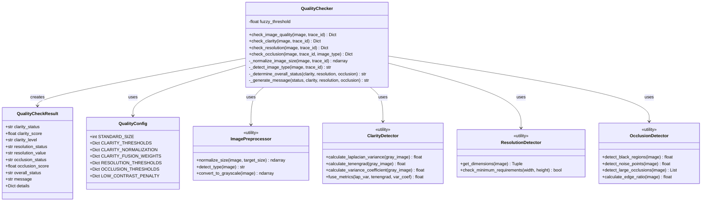
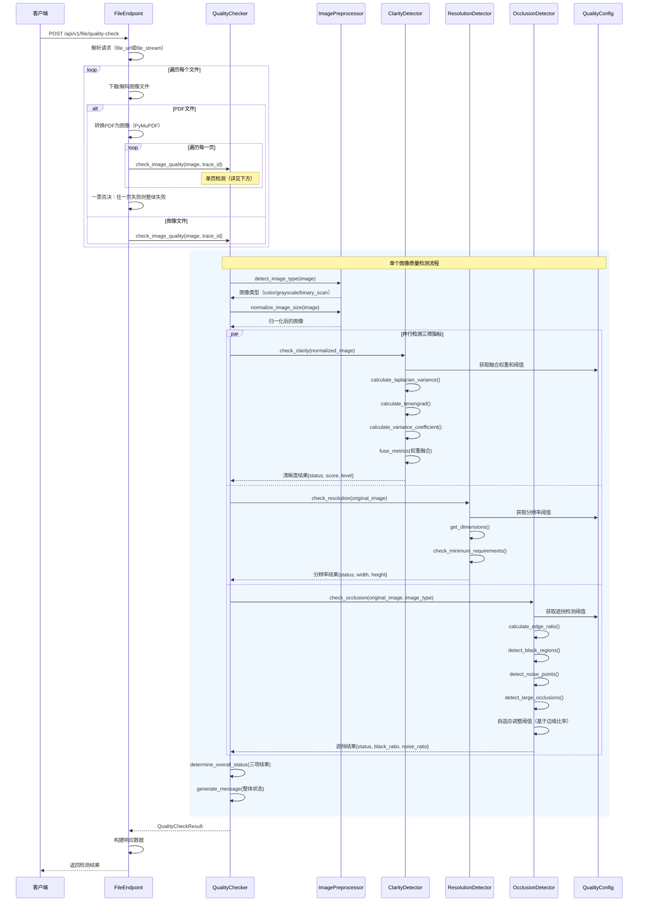

# 2.3.7 录入-文档质量检测子模块详细设计

## 2.3.7.1 类设计



### 类说明

1. **QualityChecker**：文档质量检测主类
   - 负责协调整个质量检测流程
   - 整合清晰度、分辨率、遮挡三项检测
   - 归一化图像尺寸以消除分辨率差异对检测的影响
   - 根据图像类型（彩色/灰度/黑白扫描）自适应调整检测策略

2. **QualityCheckResult**：质量检测结果数据类
   - 包含所有检测项的状态、分数和详细信息
   - 提供统一的结果格式供上层使用

3. **QualityConfig**：质量检测配置类
   - 集中管理所有检测阈值和参数
   - 支持不同场景的阈值配置
   - 包含多指标融合权重配置

4. **ImagePreprocessor**：图像预处理工具类
   - 图像尺寸归一化（消除分辨率对清晰度评分的影响）
   - 图像类型检测（彩色/灰度/黑白扫描）
   - 格式转换和标准化

5. **ClarityDetector**：清晰度检测工具类
   - 实现多指标融合算法
   - 拉普拉斯方差（边缘清晰度）
   - Tenengrad梯度（高频细节）
   - 方差系数（对比度）
   - 加权融合计算最终清晰度分数

6. **ResolutionDetector**：分辨率检测工具类
   - 检查图像尺寸是否满足最低要求
   - 提供推荐分辨率参考

7. **OcclusionDetector**：遮挡检测工具类
   - 检测黑色区域（扫描缺陷）
   - 检测噪点（小的异常区域）
   - 检测大面积遮挡
   - 计算边缘比率用于自适应调整

## 2.3.7.2 时序设计



### 时序说明

1. **请求接收**：客户端提交文件质量检测请求，支持URL或Base64流
2. **文件类型判断**：
   - PDF文件：逐页转换为图像进行检测，采用一票否决制
   - 图像文件：直接进行质量检测
3. **图像预处理**：
   - 检测图像类型（彩色/灰度/黑白扫描）
   - 归一化图像尺寸到标准评估尺寸（消除分辨率差异影响）
4. **并行三项检测**：
   - 清晰度检测：使用归一化后的图像
   - 分辨率检测：使用原始图像尺寸
   - 遮挡检测：使用原始图像，根据图像类型自适应调整
5. **结果综合**：
   - 任一项失败则整体失败
   - 任一项警告则整体警告
   - 全部通过则整体通过
6. **响应返回**：构建统一的响应格式返回给客户端

## 2.3.7.3 其他设计

**异常处理**

    **图像处理异常**：
    - 图像格式不支持：返回明确的错误信息
    - 图像损坏或无法解码：捕获并返回友好提示
    - 内存不足：降级处理或分批处理

    **PDF处理异常**：
    - PDF损坏：捕获PyMuPDF异常，返回具体错误
    - 加密PDF：提示用户提供解密密码
    - 空白页面：标记为失败，提示页面内容为空

    **计算异常**：
    - 除零错误：使用安全计算，设置默认值
    - 数值溢出：使用归一化和裁剪策略
    - 矩阵运算错误：捕获OpenCV异常，返回降级结果

    **异常处理策略**：
    ```python
    try:
        # 质量检测核心逻辑
        result = check_quality(image)
    except ValueError as e:
        logger.error(f"参数错误: {e}")
        raise QualityCheckError("图像参数不合法")
    except cv2.error as e:
        logger.error(f"OpenCV处理错误: {e}")
        raise QualityCheckError("图像处理失败")
    except Exception as e:
        logger.error(f"未知错误: {e}", exc_info=True)
        raise QualityCheckError("质量检测异常")
    ```


## 2.3.7.4 实现方式

**核心技术选型**

    1. **图像处理库**：
    - **OpenCV**：核心图像处理和质量检测算法
    - **Pillow (PIL)**：图像格式转换和基础操作
    - **scikit-image**：高级图像分析和度量计算
    - **NumPy**：高效的数组运算

    2. **PDF处理库**：
    - **PyMuPDF (fitz)**：高质量PDF到图像转换
    - 优势：渲染质量高、速度快、内存占用合理

    3. **异步处理**：
    - 同步方法：适合单个图像的快速检测
    - 支持批量文件的并发检测（在API层实现）

**多指标融合清晰度检测算法**

    采用**三指标加权融合**策略，提升评估准确性和稳定性：

    **算法流程**：

    1. **指标计算**：
    - 拉普拉斯方差（Laplacian Variance）：
        ```
        ∇²I = ∂²I/∂x² + ∂²I/∂y²
        Score_lap = Var(∇²I)
        ```
        衡量边缘清晰度，对模糊敏感
    
    - Tenengrad梯度：
        ```
        Gx = Sobel_x(I), Gy = Sobel_y(I)
        G = sqrt(Gx² + Gy²)
        Score_ten = Σ(G²) / N
        ```
        衡量高频细节，对纹理丰富度敏感
    
    - 方差系数（Variance Coefficient）：
        ```
        Score_var = (σ / μ) × 100
        ```
        衡量对比度，对曝光异常敏感

    2. **归一化**：
    将三个指标归一化到0-100区间
    ```
    Normalized_i = min(Score_i / (Ref_i / 100), 100)
    ```

    3. **加权融合**：
    ```
    Final_Score = 0.4 × N_lap + 0.4 × N_ten + 0.2 × N_var
    ```

    4. **自适应调整**：
    - 检测低对比度（过曝/欠曝）
    - 应用惩罚系数降低评分
    ```
    if Score_var < 10:
        Final_Score *= 0.7
    ```

**自适应遮挡检测**

    根据图像类型和内容特征动态调整检测阈值：

    **图像类型识别**：
    1. **彩色图像**：RGB通道差异 > 5
    2. **灰度图像**：单通道或RGB通道一致
    3. **黑白扫描件**：灰度直方图集中在黑白两端

    **自适应策略**：

    1. **边缘密度检测**：
    ```python
    edge_map = cv2.Canny(gray, 50, 150)
    edge_ratio = count_nonzero(edge_map) / total_pixels
    ```

    2. **阈值动态调整**：
    ```python
    if edge_ratio > 0.025:  # 高纹理图像
        adjust_factor = min(2.0, 1 + (edge_ratio - 0.025) * 15)
        black_threshold *= adjust_factor
        noise_threshold *= adjust_factor
    ```

    3. **黑白扫描件特殊处理**：
    - 跳过噪点检测（避免误判文字笔画）
    - 只检测极黑区域（threshold < 10）
    - 检测扫描边缘黑边
    - 使用更宽松的阈值

    **检测项目**：
    - 黑色区域占比
    - 噪点像素占比
    - 大面积遮挡检测（轮廓分析）
    - 边缘黑边检测（扫描件）

**质量标准**

    **清晰度等级**：
    - 优秀（≥80分）：适合OCR识别，细节清晰
    - 良好（60-79分）：正常使用，少量模糊
    - 一般（40-59分）：可读但质量较差
    - 较差（<40分）：严重模糊，不建议使用

    **分辨率要求**：
    - 最低：600x800px（基本可读）
    - 推荐：1200x1600px（清晰可辨）
    - 最佳：≥2400x3200px（高清扫描）

    **遮挡容忍度**：
    - 普通图像：黑色区域<10%，噪点<6%
    - 高纹理图像：动态放宽至2倍
    - 黑白扫描件：黑色区域<25%，跳过噪点检测


