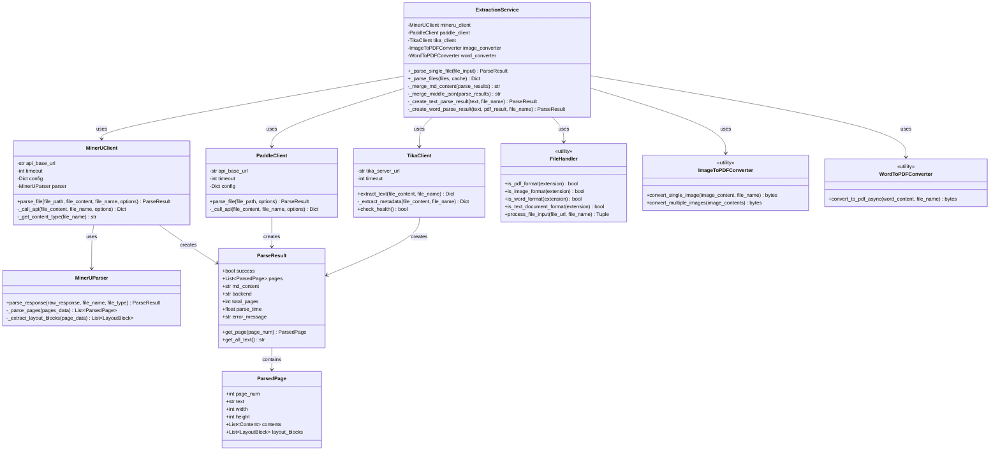
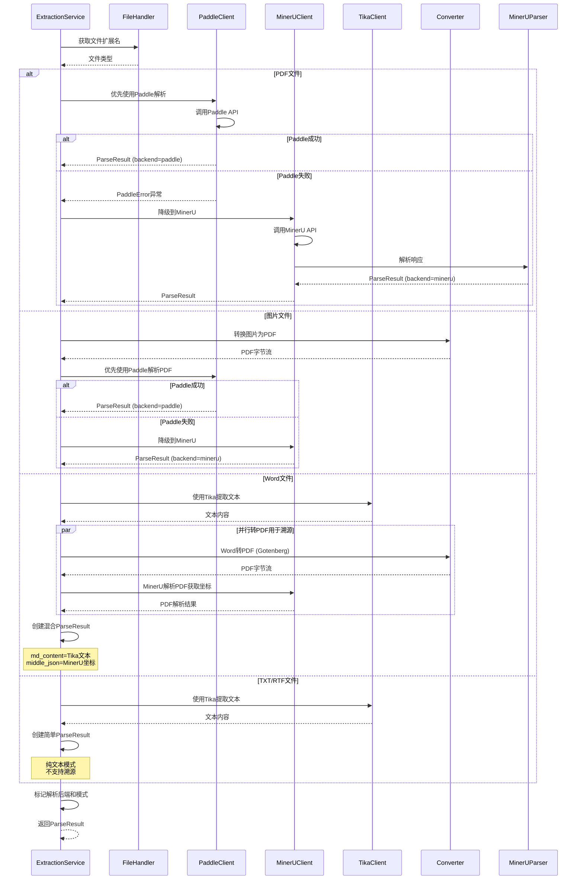

# 2.3.8 录入-文档内容解析子模块详细设计

## 2.3.8.1 类设计



### 类说明

1. **ExtractionService**：文档解析服务主类
   - 协调多个解析引擎，实现智能路由
   - 根据文件类型选择最佳解析方案
   - 支持文件批量解析和结果合并

2. **PaddleClient**：Paddle解析客户端（优先使用）
   - 基于PaddleOCR-VL的文档解析
   - 支持印章识别和高精度OCR
   - 144 DPI像素坐标系统

3. **MinerUClient**：MinerU解析客户端（降级备选）
   - Transformers后端的PDF/图片解析
   - 输出Markdown格式和坐标信息
   - 支持表格、公式识别

4. **TikaClient**：Tika文本提取客户端
   - 用于Word、TXT等文本文档
   - 快速纯文本提取
   - 不支持坐标溯源

5. **MinerUParser**：MinerU响应解析器
   - 解析MinerU API返回的复杂JSON结构
   - 提取页面、布局块、文本内容
   - 构建统一的ParseResult对象

6. **ParseResult/ParsedPage**：解析结果数据类
   - 统一的解析结果格式
   - 包含页面信息、文本内容、坐标数据
   - 支持多种后端（paddle/mineru/tika）

7. **FileHandler**：文件处理工具类
   - 文件格式识别
   - 文件下载和内容处理
   - 支持URL和Base64输入

8. **ImageToPDFConverter/WordToPDFConverter**：格式转换工具
   - 图片转PDF（用于溯源）
   - Word转PDF（通过Gotenberg服务）

## 2.3.8.2 时序设计



### 时序说明

1. **文件类型识别**：根据扩展名判断文件格式
2. **智能路由策略**：
   - PDF/图片：Paddle优先 → MinerU降级
   - Word：Tika提取 + Gotenberg转PDF + MinerU获取坐标
   - TXT：Tika提取（纯文本模式）
3. **降级机制**：Paddle服务故障时自动降级到MinerU
4. **并行处理**：Word文档同时进行文本提取和PDF转换
5. **结果标记**：标记解析后端和是否支持溯源

## 2.3.8.3 其他设计

**异常处理**

1. **解析引擎故障**：
   - Paddle故障：自动降级到MinerU
   - MinerU故障：返回解析失败
   - Tika故障：返回服务不可用

2. **文件转换异常**：
   - 图片转PDF失败：捕获异常，返回转换错误
   - Word转PDF失败：降级为纯文本模式（不支持溯源）

3. **网络异常**：
   - 超时重试：默认3次，指数退避
   - 连接失败：返回服务不可达

**配置管理**

- **PaddleConfig** (`config/paddle_config.py`)：
  - API端点、超时、重试配置
  - 降级开关：`fallback_to_mineru`
  - 144 DPI渲染参数

- **MinerUConfig** (`config/mineru_config.py`)：
  - API端点、后端选择（transformers）
  - 返回格式：md_content、middle_json、model_output
  - 表格、公式识别开关

- **TikaConfig** (`config/tika_config.py`)：
  - Tika服务器地址
  - 超时配置（60秒）

## 2.3.8.4 实现方式

**混合解析方案决策**

根据文件特点选择最佳解析引擎：

| 文件类型 | 解析引擎 | 输出格式 | 溯源支持 | 优势 |
|---------|---------|---------|---------|------|
| PDF | Paddle → MinerU | Markdown + 坐标 | ✅ | 高精度OCR + 印章识别 |
| 图片 | Paddle → MinerU | Markdown + 坐标 | ✅ | 自动转PDF + 结构化识别 |
| Word | Tika + Gotenberg + MinerU | 文本 + 坐标 | ✅ | 快速提取 + 支持溯源 |
| TXT | Tika | 纯文本 | ❌ | 快速轻量 |

**Paddle优先策略**

1. **优势**：
   - PaddleOCR-VL高精度识别
   - 印章检测和提取
   - 更准确的表格识别
   - 144 DPI像素坐标（适合高亮）

2. **降级条件**：
   - Paddle API返回错误
   - 超时或连接失败
   - 解析结果success=False

3. **降级流程**：
   ```python
   try:
       result = await paddle_client.parse_file(file_path)
       if result.success:
           return result
       else:
           raise PaddleError("Paddle解析失败")
   except (PaddleError, Exception):
       if config['fallback_to_mineru']:
           logger.info("降级到MinerU")
           return await mineru_client.parse_file(file_path)
       else:
           raise
   ```

**Word文档双模式处理**

Word文档需要同时满足两个需求：
1. **快速文本提取**（用于LLM提取）→ Tika
2. **坐标溯源**（用于PDF高亮）→ 转PDF + MinerU

**实现流程**：
```python
# 1. Tika提取文本（快速）
text = await tika_client.extract_text(word_content)

# 2. Gotenberg转PDF
pdf_bytes = await word_converter.convert_to_pdf(word_content)

# 3. MinerU解析PDF获取坐标
pdf_result = await mineru_client.parse_file(pdf_bytes)

# 4. 创建混合结果
return WordParseResult(
    md_content=text,           # Tika文本（用于提取）
    pages=pdf_result.pages,    # MinerU坐标（用于溯源）
    is_word_document=True,     # 标记Word模式
    pdf_content=pdf_bytes      # 保存PDF用于高亮
)
```

**MinerU配置优化**

选择**Transformers后端**：
- 更稳定的解析效果
- 更好的表格、公式识别
- 输出格式：
  - `md_content`：Markdown格式（给LLM）
  - `middle_json`：坐标信息（用于溯源）
  - `model_output`：详细解析数据

**批量文件并行解析**

支持多个文件同时解析，提升效率：

```python
async def _parse_files(files):
    # 创建并行任务
    tasks = [parse_single_file(f) for f in files]
    
    # 并发执行
    results = await asyncio.gather(*tasks, return_exceptions=True)
    
    # 按file_type分组并合并
    grouped_results = group_by_file_type(results)
    
    return {
        file_type: {
            "md_content": merge_md_content(results),
            "middle_json": merge_middle_json(results)
        }
        for file_type, results in grouped_results.items()
    }
```

**结果合并策略**

同一file_type的多个文件合并为一个逻辑文档：

1. **md_content合并**：
   - 添加文件分隔符：`# === 文件名 ===`
   - 保持原始文本格式
   - 适合LLM理解多文件上下文

2. **middle_json合并**：
   - 调整页码：累加页面偏移量
   - 保持坐标数据完整性
   - 支持跨文件溯源

**性能优化**

1. **缓存机制**：
   - 文件哈希检测，避免重复解析
   - 提取阶段的解析结果可复用到审核阶段

2. **流式处理**：
   - 大文件逐块下载
   - 及时释放内存

3. **并发控制**：
   - 限制并发解析数量
   - 避免API服务过载

4. **降级开关**：
   - 可配置是否启用MinerU降级
   - 生产环境建议开启


