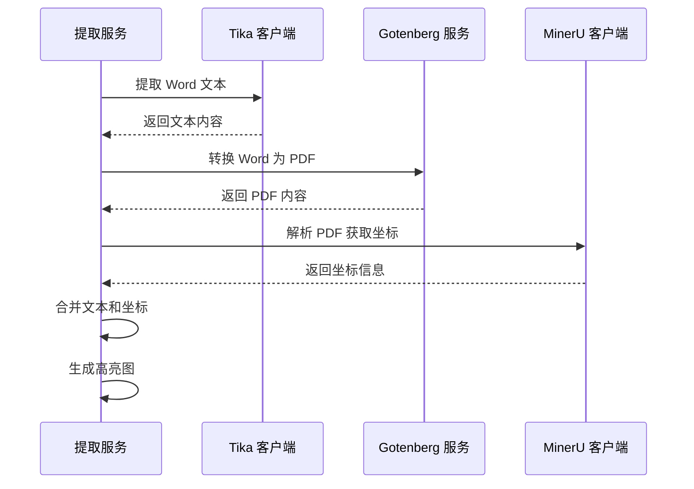

# Gotenberg 集成文档

## 概述

本项目已从 `docx2pdf`（仅支持 Windows）迁移到 [Gotenberg](https://gotenberg.dev/)（跨平台 Docker 服务）来实现 Word 转 PDF 功能。

## 架构变更

### 之前（docx2pdf）
```
Word 文档 → docx2pdf（本地 Windows 库）→ PDF
```

**限制**：
- 仅支持 Windows 系统
- 依赖本地安装的 Microsoft Office 或 LibreOffice
- 无法在 Linux/Docker 环境中使用

### 现在（Gotenberg）
```
Word 文档 → HTTP API → Gotenberg 服务（LibreOffice）→ PDF
```

**优势**：
- ✅ 跨平台支持（Linux/Windows/macOS）
- ✅ Docker 容器化部署
- ✅ 无需本地安装 Office 软件
- ✅ 支持多种文档格式（Word、Excel、PowerPoint 等）
- ✅ 高性能、可扩展

## 服务配置

### Gotenberg 服务地址
```
地址: http://101.126.54.157:7582
端口: 7582
状态: 运行中
```

### 配置文件
**文件路径**: `config/gotenberg_config.py`

```python
class GotenbergConfig(BaseSettings):
    # Gotenberg 服务地址
    gotenberg_server_url: str = "http://101.126.54.157:7582"
    
    # 转换超时时间（秒）
    gotenberg_timeout: int = 60
    
    # 是否启用 Gotenberg
    gotenberg_enabled: bool = True
    
    # PDF/A 格式（可选）
    gotenberg_pdfa_format: str = ""
    
    # 其他配置...
```

### 环境变量配置
可以在 `.env` 文件中覆盖默认配置：

```bash
# Gotenberg 服务配置
GOTENBERG_SERVER_URL=http://101.126.54.157:7582
GOTENBERG_TIMEOUT=60
GOTENBERG_ENABLED=true
```

## API 使用

### GotenbergClient

**文件路径**: `src/services/gotenberg/client.py`

#### 基本用法

```python
from src.services.gotenberg.client import GotenbergClient

# 创建客户端
client = GotenbergClient()

# 检查服务是否可用
if client.is_available():
    print("Gotenberg 服务可用")

# 转换 Word 文档为 PDF
pdf_content = await client.convert_word_to_pdf(
    word_content=word_bytes,
    file_name="document.docx"
)
```

#### 高级功能

```python
# 转换 Office 文档（支持 Word、Excel、PPT）
pdf_content = await client.convert_office_to_pdf(
    file_content=file_bytes,
    file_name="document.xlsx",
    landscape=True,          # 横向打印
    pdfa_format="PDF/A-1b",  # PDF/A 格式
    merge=False              # 是否合并多个文件
)

# HTML 转 PDF
pdf_content = await client.convert_html_to_pdf(
    html_content="<html><body><h1>Hello</h1></body></html>",
    margin_top=1.0,
    margin_bottom=1.0
)

# 合并多个 PDF
merged_pdf = await client.merge_pdfs([
    ("file1.pdf", pdf_bytes_1),
    ("file2.pdf", pdf_bytes_2)
])
```

### WordToPDFConverter

**文件路径**: `src/utils/word_converter.py`

保持原有的接口不变，但底层实现改为使用 Gotenberg：

```python
from src.utils.word_converter import WordToPDFConverter

# 检查转换器是否可用
if WordToPDFConverter.is_available():
    print("Word 转 PDF 功能可用")

# 异步转换（推荐）
pdf_bytes = await WordToPDFConverter.convert_to_pdf_async(
    word_content=word_bytes,
    file_name="document.docx"
)

# 同步转换（兼容旧代码）
pdf_bytes = WordToPDFConverter.convert_to_pdf(
    word_content=word_bytes,
    file_name="document.docx"
)
```

## 集成到提取服务

在 `src/services/extraction/service.py` 中，Word 文档的处理流程：

```python
# 1. 提取阶段：使用 Tika 提取文本
tika_result = await self.tika_client.extract_text(
    file_content=file_content,
    file_name=file_input.file_name
)

# 2. 溯源阶段：使用 Gotenberg 转换为 PDF
pdf_content = await WordToPDFConverter.convert_to_pdf_async(
    word_content=file_content,
    file_name=file_input.file_name
)

# 3. 解析 PDF 获取坐标信息
pdf_parse_result = await self.mineru_client.parse_file(
    file_path=tmp_pdf_path
)

# 4. 创建混合解析结果
parse_result = self._create_word_parse_result(
    text_content=tika_result["text"],      # 用于 LLM 提取
    pdf_parse_result=pdf_parse_result,     # 用于溯源坐标
    file_name=file_input.file_name,
    pdf_content=pdf_content                # 用于高亮图生成
)
```

## 完整流程图



## 部署说明

### Gotenberg 服务部署

```bash
# 使用 Docker 部署 Gotenberg
docker run -d \
  --name gotenberg \
  -p 7582:3000 \
  --restart unless-stopped \
  gotenberg/gotenberg:8
```

### 验证服务

```bash
# 检查服务健康状态
curl http://101.126.54.157:7582/health

# 测试 Word 转 PDF
curl --request POST \
  http://101.126.54.157:7582/forms/libreoffice/convert \
  --form files=@test.docx \
  -o output.pdf
```

## 故障排查

### 问题 1: 连接超时

**症状**: `Gotenberg 转换超时（60秒）`

**解决方案**:
1. 检查 Gotenberg 服务是否运行
2. 增加超时时间：`GOTENBERG_TIMEOUT=120`
3. 检查网络连接

### 问题 2: 服务不可用

**症状**: `Gotenberg 服务不可用`

**解决方案**:
1. 检查服务地址配置是否正确
2. 验证服务健康：`curl http://101.126.54.157:7582/health`
3. 查看 Gotenberg 容器日志：`docker logs gotenberg`

### 问题 3: 转换失败

**症状**: `Gotenberg 转换失败 (HTTP 400/500)`

**解决方案**:
1. 检查文件格式是否支持
2. 验证文件内容是否完整
3. 查看错误响应详情

## 性能优化

### 并发处理

Gotenberg 支持并发请求，建议：
- 使用异步方法 `convert_to_pdf_async`
- 合理设置超时时间
- 监控服务负载

### 缓存策略

对于重复转换的文档，可以考虑：
1. 缓存转换结果
2. 使用文件哈希作为缓存键
3. 设置合理的缓存过期时间

## 相关资源

- **Gotenberg 官网**: https://gotenberg.dev/
- **API 文档**: https://gotenberg.dev/docs/routes
- **Docker Hub**: https://hub.docker.com/r/gotenberg/gotenberg
- **GitHub**: https://github.com/gotenberg/gotenberg

## 变更日志

### v1.0 (2025-11-07)
- ✅ 从 docx2pdf 迁移到 Gotenberg
- ✅ 创建 GotenbergClient 和配置
- ✅ 更新 WordToPDFConverter 实现
- ✅ 集成到提取服务流程
- ✅ 支持 Word 文档溯源和高亮


