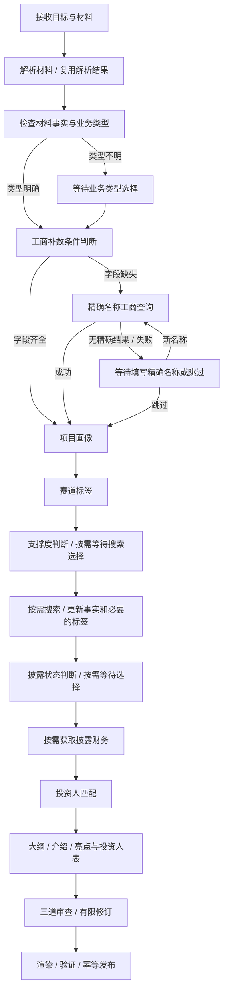

# 一页纸 BP：持久执行检查点与明确恢复位置

- 日期：2026-10-29
- 状态：分批实施；第一批已有实现，完整业务图仍为设计提案
- 落地进展：已按缩小后的第一批范围，在现有 Agent 图上接入检查点与真实恢复；见[第一批修改记录](../change-notes/2026-10-29-one-pager-checkpoints.md)和 [ADR-0003](adr/0003-one-pager-resumable-harness.md)。本文固定业务图、完整命令表和写作次数目标仍为后续设计，不代表已实现。
- 范围：一页纸 BP；保留现有投资报告入口与 Data MCP 公共契约
- 目标：卡片回答后从确定位置继续，复用成功结果，减少主模型调用，并能在进程重启后恢复

## 1. 当前问题与实际基线

当前的“继续当前任务”保留了 task/session/workspace 和文字记忆，但没有恢复执行位置：

1. `application/runs.py` 的 `submit()` / `resume()` 接收回答，再启动一个新执行片段。
2. `application/bootstrap.py` 构造全新 Deep Agent，传入历史 user/assistant 文本。
3. `AgentBuildSpec` 支持 checkpointer，但当前调用没有传入。
4. 提问通过 `return_direct` 或 `jump_to:end` 结束图；这不是可恢复的 `interrupt`。
5. Skill 要求先规划六步、反复拆子任务。模型重新阅读上下文后，自行决定再查哪些工具。

因此，“同一任务”“有工作记忆”“前端恢复了卡片”都不能保证从暂停位置续跑。单纯接入 saver 也不能消除工具之间的规划调用。

本次读取本地 `logs/agent.ndjson` 的一个已完成一页纸任务，得到以下诊断基线：

| 任务 | 日志执行片段 | 主模型调用次数 | 模型调用累计耗时 |
| --- | --- | ---: | ---: |
| `task_4fba67d46a4a41e3b28260d007681170` | 第 1 段 | 25 | 151.3 秒 |
| 同上 | 第 2 段 | 43 | 348.8 秒 |
| 合计 | 2 段 | 68 | 500.1 秒 |

第二段又执行了 `parse_materials`、材料分页读取和 `query_track_labels`；同时出现五次大纲校验、三次渲染。不能仅凭工具名称断定全部调用都可删除，但可以确认存在重复前置工作和多轮修订。

这些数字是该历史任务的主模型日志累计值，不是当前版本性能承诺，不包括 Data MCP 内部模型、OCR、网络工具或用户等待时间，也不是整个任务的墙钟耗时。

## 2. 核心决策

采用 **LangGraph 持久工作流控制业务步骤，通过现有 Harness 边界执行有边界的写作调用**。第一批复用 Deep Agent 写作，目标路径改为每个写作节点一次结构化模型调用，由程序校验和落盘。

- 外层：程序决定当前节点、分支、暂停、恢复、失效重算、重试和预算。
- 内层：模型处理材料的可选语义判断、大纲、介绍、亮点和必要修订。
- 固定动作：材料解析、证据读取、MCP 调用、用户卡片、规则校验、渲染和发布由程序直接调用服务，不让主模型逐个选择工具。
- 用户卡片：使用明确的选项值和字段约束；后端校验后直接恢复，不需要模型把“增资”“跳过”再解释一遍。
- 进度：从工作流状态投影六步进度，不再通过 `write_todos` 生成业务进度。

这延续 [ADR-0001](adr/0001-deep-agents-harness-boundary.md) 的 LangGraph/Deep Agents 基座与 factory 边界，以及 [ADR-0002](adr/0002-use-existing-mysql-for-langgraph-checkpoints.md) 的 MySQL 选择。需要工具循环的写作仍由 Deep Agents 承担；一次结构化模型调用是图节点内部的模型适配，不是另一套 Agent 内核。实施前新增 ADR，明确外层业务图与内层写作 Harness 的职责。

**不采用只给现有大 Agent 增加一个 `next_step` 提示的方案。** 该字段可以用于展示，但执行位置必须由已提交的图检查点决定，不能交给模型遵守提示词。

## 3. 工作流与恢复点

以下是逻辑阶段；每次外部调用、模型调用和需要独立恢复的动作，都拆成独立图节点。



保留当前交付要求：介绍与亮点分步生成、证据约束、三道审查、模板约束、投资人匹配表和稳定下载接口。减少规划调用不意味着跳过这些要求。

| 暂停节点 | 触发条件 | 接受的回答 | 回答后的明确位置 | 应复用的前置结果 |
| --- | --- | --- | --- | --- |
| `wait_material_relevance` | 材料与目标明显不符 | 继续 / 重新上传 | `inspect_materials` 或继续等待材料 | 已上传文件和解析结果 |
| `wait_business_type` | 无法确认产权/增资 | `property` / `capital_increase` | `registry_gate` | 材料、事实检查 |
| `wait_registry_name` | 未精确匹配、无结果或服务失败 | `correct_name` + 名称 / `skip` | `query_registry` / `extract_profile` | 材料、已确认业务类型 |
| `wait_web_permission` | 信息支撑度不足 | `search` / `skip` | `search_web` / `listing_gate` | 工商、画像、标签 |
| `wait_listing_status` | 材料没有明确披露状态 | `yes` / `no` / `unknown` | `query_listing_financials` / `match_investors` | 全部已有效补数结果 |

各 gate 先读已确认的选择。选择仍有效时不重复提问；只有对应输入发生实质变化或用户明确更正时才重新评估。

搜索补充改变实际传入的 profile 时，要按依赖指纹刷新标签/匹配输入，再进入披露判断；保留已有搜索选择，不因回到数据节点重复提问。

名称重试每次都需要用户提交一个新名称；同一失败名称的重复提交只返回既有提示，保留“跳过”。服务失败不是报告失败，用户跳过后不再自动查询。

## 4. 状态与身份

保持 task、session、workspace、run 的既有职责，增加独立工作流身份：

| 字段 | 职责与稳定性 |
| --- | --- |
| `task_id` | 当前业务任务；卡片、补充文字、更正材料都属于该任务 |
| `session_id` | 对话会话；不拿它兼任数据库执行锁 |
| `workspace_id` | 材料、证据、文稿与产物所属空间 |
| `workflow_id` | 一次一页纸工作流实例；不随 HTTP 请求或卡片回答变化 |
| `thread_id` | 由 workflow_id 派生，例如 `one-pager:{workflow_id}`；不使用 run_id |
| `run_id` | 本次启动/恢复执行片段的审计标识；允许变化，不代表从头开始 |
| `graph_version` | 固定节点拓扑与状态语义；实例创建后固定 |
| `state_revision` | API 并发校验版本；每次有效业务状态变更递增 |
| `input_revision` | 用户实质更改输入时递增；普通按钮回答不使整条链路失效 |
| `question_id` | 当前问题的业务标识，跨刷新/重启稳定 |
| `interrupt_id` | LangGraph 暂停实例标识，供受控恢复适配器使用 |
| `checkpoint_id` | 引擎检查点；客户端只能回传校验，不能指定任意历史点执行 |

建议 `OnePagerState` 包含：

```text
schema_version, graph_version, workflow_id
task_id, session_id, workspace_id
objective, state_revision, input_revision
materials[]: {material_id, sha256, parser_version, parsed_ref}
facts_ref, company_name, business_type
decisions: {material_relevance, registry, web, listing}
steps[node]: {status, input_hash, output_refs, result_kind, attempts}
pending_question: {question_id, gate, options, input_schema, resume_target}
evidence_refs, missing_items, warning_refs
outline_ref, introduction_ref, highlights_ref, markdown_ref
review_ref, repair_rounds, render_manifest_ref, published_artifact_refs
context_notes_ref, applied_message_ids
budget: {generation_id, model_attempts, tool_attempts, active_seconds}
```

每个步骤结果区分 `success`、`empty`、`skipped`、`retryable_error`、`failed`。`empty` 和用户 `skipped` 都是合法完成状态；不能因“调用过工具”就算成功，也不能因“没有 artifact”就推断必须向用户提问。

检查点保存结构化状态和证据引用。完整材料、大段工具原始响应和二进制文件留在持久工作空间/对象存储，避免每个检查点复制全文。写作节点只读所需事实包和相关用户补充。

`conversation.json`、`interaction.json` 和 `run-state.json` 继续用于审计或兼容展示，但从工作流投影生成，不再与检查点各自维护一套执行真值。旧 `completed_tools` 不能作为恢复游标，因为它不含本次请求参数、结果是否成功和依赖版本。

## 5. 真正暂停和恢复的实现

### 5.1 等待节点保持无副作用

一次等待拆成三个阶段：

1. `prepare_question`：程序生成规范问题与稳定 question_id，提交节点检查点。
2. `wait_*`：只调用 `interrupt(question)`，恢复后校验回答并返回状态更新。
3. 后续节点：按回答执行新查询或跳过，成功后再提交检查点。

本地锁定版本 `langgraph==1.2.11` 的 `interrupt` 明确会在恢复时从当前节点开头重执行。因此不能把“调用企查查、发消息、发布文件、累计预算”等动作放在 `interrupt` 之前。同一等待节点只设一个 interrupt，避免动态插入问题改变恢复值匹配次序。

示意代码仅说明接口关系，生产实现还需持久命令、并发校验和幂等逻辑：

```python
def wait_business_type(state):
    answer = interrupt(state["pending_question"])
    selection = validate_business_type_answer(answer)
    return {"business_type": selection, "pending_question": None}

# 新任务：仅初始化一次；节点输出由检查点累计。
await graph.ainvoke(initial_state, config=thread_config, durability="sync")

# 卡片回答：恢复现有 interrupt，不重新传一整份对话历史。
await graph.ainvoke(
    Command(resume={interrupt_id: validated_answer}),
    config=thread_config,
    durability="sync",
)

# 进程异常中断：确认没有待回答的 interrupt 后，继续未完成的节点。
await graph.ainvoke(None, config=thread_config, durability="sync")
```

`thread_config` 定位受服务端控制的工作流当前分支。旧 checkpoint_id 仅用于乐观并发比较，不能直接将它作为恢复配置，否则可能从历史检查点分叉重跑。

检查点写入失败时停止前进。面向用户的“正在等待回答”“已完成某步骤”必须在对应状态可持久读取后才发布。等待用户时不保持 Python 调用栈、数据库事务或数据库连接。

### 5.2 API：回答是恢复命令

新增 `POST /api/tasks/{task_id}/answers`，示例：

```json
{
  "question_id": "question_example",
  "expected_state_revision": 12,
  "expected_checkpoint_id": "checkpoint_example",
  "client_request_id": "browser-generated-uuid",
  "choice_value": "capital_increase",
  "fields": {},
  "message": "本轮融资计划为五千万元"
}
```

后端从数据库查出 workflow/thread/interrupt；客户端不决定执行节点。流程为：

1. 短事务校验待处理问题、state_revision 和权限，按 client_request_id 幂等写入恢复命令，并记录原始补充文字。
2. 提交后返回 `202` 和执行片段标识，状态为 `resume_queued`；此时只表示已接收，不能声称图已恢复。
3. 单一 worker 领取命令，重新校验当前图中的问题和检查点，调用 `Command(resume=...)`。
4. 检查点已反映该回答后，将命令标记 applied，投影任务状态与卡片结果。

同一问题只能接收一个有效回答。重复 request_id 返回原接收结果；不同请求争抢同一问题时后者返回 `409` 和最新快照。HTTP 响应丢失后重试不会启动第二段执行。

若在回答已写入图后、命令尚未标记 applied 时崩溃，恢复时通过 `applied_message_ids`/决策来源命令 ID 对账，补齐命令状态，不再次向下一张卡片投递旧回答。

现有 `/api/runs/{run_id}/resume` 和开发提交接口暂保留：对新工作流转译成上述命令，不能再走 fresh-agent submit。新任务创建和待回答问题必须分别处理。

### 5.3 补充输入进入当前任务记忆

所有额外文字先写入当前 task 的追加式消息记录，带 message_id、来源 question_id 和用户提供事实标记；不能重置 objective 或重新选 Skill。

- 卡片附言：与选择一起保存，更新事实包/写作上下文；按钮分支不需要模型解释。
- 等待中仅发送文字：保存为补充；无法通过当前问题字段校验时继续保留卡片，提示仍需选择。支持明确的旧别名映射，但不根据任意聊天内容猜测确认。
- 正在执行时补充：写入命令收件箱，worker 在节点边界吸收；不从 API 并发调用 `update_state` 修改运行中的图。
- 用户明确更正名称、业务类型或融资数据：生成受控输入变更，计算受影响节点，不清空全任务。
- 已发布后请求修改：同一 task 内生成新文稿版本，保留原产物；显式开启新的生成预算。

任意文字中包含“新项目”等词不能自动创建任务。创建新任务必须来自用户明确操作或单独确认。待处理补充必须在下一次写作前吸收，不能收到后只存日志而未进入实际上下文。

## 6. 持久化、worker 与故障恢复

### 6.1 MySQL saver 的实际接入

已安装：`langgraph-checkpoint-mysql==3.0.0`，目前依赖仅启用 `[pymysql]`；`aiomysql` / `asyncmy` 驱动都未安装。现有 `open_mysql_checkpointer()` 是同步 adapter，不能直接视为异步持久化已完成。

建议增加锁版本的 `[aiomysql]` extra，由 `infrastructure/persistence/checkpoints.py` 暴露项目自有异步生命周期 adapter。当前包实际提供 `AIOMySQLSaver`，其基类支持异步连接池；实施时用显式配置构造连接池，验证连接参数、utf8mb4、自动提交、超时、断线和池回收，不能只验证 import。

- API/worker lifespan 打开池并在关闭时释放；构图发生在对应事件循环中。
- 业务元数据和 checkpoint 使用现有 MySQL 实例，checkpoint 按 ADR 使用专用 schema。
- saver 原生表由其 `setup()` 管理，只能在显式迁移命令执行；现有 SQL 迁移入口需要增加 checkpoint 迁移子命令，不能在应用启动隐式建表。
- 初期使用 `durability="sync"`，先提交节点检查点再进入下一步；不要只在整图退出时保存。
- 等待输入后释放任务执行资源；下一次 HTTP 请求/进程可以重新构造相同版本图并读取检查点。

### 6.2 最小业务持久层

保留现有 tasks/sessions/runs/artifacts 表。建议新增三类表，字段以下述职责为准，实施时再定迁移编号：

| 表 | 关键字段与职责 |
| --- | --- |
| `report_agent_workflows` | workflow_id、task_id、thread_id、graph_version、status、state_revision、checkpoint_head、pending_question_id、当前执行片段、更新时间；一个活跃工作流对应一个任务 |
| `report_agent_workflow_commands` | command_id、workflow_id、kind、client_request_id、question_id、payload、status、attempts、领取状态；兼作持久收件箱与简单工作队列 |
| `report_agent_step_results` | workflow_id、node、input_hash、执行版本、结果类型、output_refs、预算计数、耗时；唯一键保证同一有效请求复用结果 |

命令保存提交顺序；问题回答的唯一性约束独立于 request_id。状态投影与检查点不假设处于同一事务：worker 每次启动和领取命令时读取引擎真值，对账并修复落后的投影。

第一阶段采用 **单个持久 worker + MySQL 命令表**，不同时引入 Redis 队列平台。API 可以快速返回，worker 的重启不会丢失已接收命令。原有 `asyncio.create_task` 和 `_active_tasks` 不能承担持久排队与跨进程排他职责。

第一阶段只允许一个 worker 部署实例。故障接管必须在确认旧进程退出后进行，不能仅因租约过期启动第二个执行者。租约用于发现失联，不足以阻止旧进程继续写入 saver。多 worker 自动接管要另行实现并测试 checkpoint 写入和发布操作的 fencing；在此之前不宣称支持多 worker 并发恢复。

### 6.3 恢复规则

| 已持久状态 | worker 恢复动作 |
| --- | --- |
| waiting_input，无恢复命令 | 保持等待；不调用模型或 MCP |
| waiting_input，有已接收回答 | 检查问题是否仍对应当前 interrupt，恢复一次 |
| running，旧进程确认退出 | 校验依赖输出，再从未提交完成的节点继续 |
| 外部结果已持久化，图节点未提交 | 读 step_results 回填节点输出，不重新调用外部服务 |
| 图已使用回答，命令未 applied | 对账补记，不将旧回答投递给后续问题 |
| 引用文件缺失/哈希不符 | 标记明确的恢复错误；不将损坏引用当完成，也不静默重跑全部 MCP |
| graph_version 不受当前部署支持 | 停止调度并提示版本不兼容；不让新节点拓扑解释旧检查点 |
| completed | 直接读产物和版本信息；下载不触发模型 |

停机时先停止领取命令，再等待/取消当前安全节点并关闭池。取消状态、已消耗预算和已完成结果都要持久化，用户再次恢复不能重置预算。

## 7. 结果复用、输入变更与外部副作用

### 7.1 复用键

建议：`sha256(node_version + tool_contract_version + canonical_actual_inputs + upstream_content_hashes)`，并按 workflow/task 隔离。

节点入口先查有效结果；命中后直接返回引用。成功查询与模型输出在验证后先持久化结果，再返回图状态。失败重试不能复用为成功；空标签、用户跳过等合法结果要能复用。

| 节点 | 必须参与请求指纹的输入 |
| --- | --- |
| 材料解析 | 所有相关文件 SHA-256、解析/OCR 配置与版本 |
| 工商查询 | 精确公司名称、服务/契约版本、结果有效期 |
| 项目画像 | 材料全文哈希、company_name、实际请求参数与服务版本 |
| 标签/投资人 | 实际传入的 profile、tags、company_name、服务版本 |
| 大纲/写作 | 有效事实包、用户补充、业务类型、写作规则与模型配置版本 |
| 审查 | Markdown 内容哈希、审查器和规则版本 |
| 渲染 | Markdown、业务类型、模板/渲染器版本、影响产物的参数 |
| 发布 | task_id、文稿版本、最终文件 SHA-256、发布规则版本 |

跨 HTTP 的短期签名 URL 不作为材料内容版本。导出 URL 失效时重签同一份材料，不重新解析或提取画像。活跃任务默认固定已获取证据版本；只有用户主动刷新或规则要求更新时重查，避免每次卡片回答都因 TTL 变化重跑。

### 7.2 只重算依赖后缀

- 改业务类型：重新评估大纲、写作和模板；材料解析、公司不变的工商/画像/标签通常复用。以实际依赖输入为准。
- 改公司名称：复用解析结果；工商、包含公司名的画像/标签/匹配请求重新计算。不能把旧公司的证据带给新公司。
- 改披露选择：更新财务分支与引用该财务的写作/渲染，不重跑无关工商和解析。
- 加材料：只解析新哈希文件，更新事实包及受影响数据节点。
- 仅调整措辞：从写作或修订开始；仅改文件展示名时按产物策略处理。

失效依据明确字段与实际请求哈希，不根据“工具以前执行过”或模型一句“需要重新查询”决定。

### 7.3 崩溃边界与发布幂等

检查点不能保证外部调用恰好一次。如果外部 API 已返回、但结果尚未落库时进程崩溃，恢复可能再次查询；读操作接受这一边界并记录重复尝试。若上游支持幂等键，则透传调用键。

发布必须额外实现业务幂等：

1. 渲染后完整保存可重建的 manifest，包含业务类型、路径、SHA、验证结果、文稿版本和模板版本。现有 `.render.json` 可扩展，但当前发布查找依赖进程内 `_registry`，需要实现持久化重建。
2. 用 task + 文稿版本 + SHA 确定发布键与对象路径；对象已经存在且 SHA 一致时复用。
3. 上传成功后数据库登记中断时，恢复能通过同一对象路径对账补登记。
4. 原子登记产物和发布结果唯一键；并发/重复命令返回同一产物，不生成另一份发布。
5. 继续统一使用 `/api/artifacts/{artifact_id}/content`，按钮、正文与右侧预览从同一产物引用生成下载地址。

## 8. 限制模型调用与等待时间

### 8.1 正常路径调用预算

以下为设计目标，实施后用同材料实测；不承诺直接达到某个秒数。

| 工作 | 主模型目标次数 | 实现方式 |
| --- | ---: | --- |
| 解析、证据读取、MCP 调度、计划进度 | 0 | 程序节点直接调用适配器 |
| 材料语义检查 | 0–1 | 规则先判断；必要时一次提取意图/事实缺失，类型不确定仍提问 |
| 卡片选择与恢复 | 0 | 规范枚举、字段校验与条件边 |
| 大纲 | 1 | 结构化返回，程序校验 |
| 介绍三段 | 1 | 一次返回三段及证据引用；保留分步写作 |
| 亮点三段与投资人表 | 1 | 事实包 + 已有介绍，避免重复；表格优先由程序组装 |
| 质量修订 | 0–2 | 汇总校验问题，一轮集中修复受影响内容 |
| 审查调用、渲染、发布、完成回复 | 0 次额外主模型规划 | 直接调用现有审查服务/规则；完成回复使用产物模板 |

正常写作目标为 **3–4 次成功主模型调用**；最多两轮集中修订。每次显式生成/修订请求建议硬上限 **8 次主模型请求尝试**，包含失败与传输重试，持久化累计；卡片暂停/恢复不重置。超限进入 `needs_review`，保留草稿和阻断原因，不能自动放宽发布校验。

达到该目标的前提是写作节点通过 Harness 的单次结构化调用适配器返回标题、段落、证据引用，程序完成 `write_file`/`edit_file` 对应的落盘。若继续让 Deep Agent 自由选择文件工具再回到模型总结，就不能把一个写作节点计作“一次调用”；首批兼容模式要如实记录实际请求数。自动命名等辅助调用也单独统计，不能藏入主流程节省量。

审查服务或 Data MCP 内部如另有模型调用，必须单独计数，不计入上述“主模型次数”来制造降本假象。现有提取画像、标签兜底等外部耗时仍存在；通过结果复用减少重复调用，而不是声称它们不耗时。

### 8.2 超时与重试

- 依据节点分别配置模型、OCR、MCP、渲染超时，禁止所有步骤共用长超时。
- 校验失败做局部修复，不重跑补数。
- 网络错误最多一次有界自动重试；上游明确失败按工具的可选/必选策略处理。
- 工商无精确名称不自动重试；空标签不自动循环。
- 当前按 run 重新创建的 `RunBudget` 要升级为文稿生成周期累计预算，记录已发起尝试；重复点击和服务重启不获得新预算。
- 计时拆分为用户等待、排队、主模型、Data MCP、渲染与持久化；活跃执行预算不计用户等待。
- UI 直接展示“已恢复，正在匹配投资人”等节点状态，不额外调用模型生成每一步说明。

初期保持串行可验证的节点依赖。稳定后，仅并行没有读写依赖的查询；不把“并行更多外部工具”作为第一批降时措施。

## 9. 前端与事件恢复

任务快照增加 `workflow_id`、`graph_version`、`state_revision`、`current_node`、`waiting_at`、`resume_target`、`steps` 和待处理命令状态。引擎中的当前待执行节点是恢复依据；`resume_target` 是程序计算的展示字段，不能从前端写入。

- 回答后保留已完成六步和工具结果，更新等待卡状态与当前节点，不清空整张计划。
- 卡片由 gate 注册表提供固定选项和字段约束；业务类型永远是两个明确选择，工商卡永远有补正和跳过入口，披露卡为是/否/不确定。
- 新 run_id 只表示新执行片段；前端仍订阅同一 workflow/task 的连续进度。
- 首先从数据库投影快照恢复真实状态；SSE 只通知变化，丢失消息也不能导致卡片消失或步骤倒退。

第一阶段不另建事件队列表：使用持久任务版本轮询/状态对账，SSE 作为实时加速；断线、重启、游标缺口均先请求快照。需要完整工具事件回放时，再增加持久事件/outbox 表和 task 级事件序号。现有进程内 event bus 不能被描述为持久事件流。

## 10. 代码落点与实施顺序

以下新增名称为建议，尚未创建业务实现：

| 位置 | 工作 |
| --- | --- |
| `application/one_pager_workflow/`（新增） | 状态定义、节点、依赖失效、问题工厂、恢复用例 |
| `harness/workflows/`（新增） | LangGraph 构图与 interrupt/Command 适配；业务服务不依赖私有图实现 |
| `harness/factory.py` / 写作模型适配器 | 首批构建有界写作 Agent；后续提供单次结构化模型调用，程序负责文稿落盘，不赋予重新调度全业务流程的权限 |
| `infrastructure/persistence/checkpoints.py` | 异步 saver/连接池生命周期与检查点查询适配 |
| `infrastructure/persistence/`（新增仓库） | workflows、commands、step_results 与状态对账 |
| `application/runs.py` / `bootstrap.py` | one-pager 分发到持久工作流；其他 Skill 维持现有执行入口 |
| `application/one_pager_reports.py` | manifest 重建、渲染恢复、发布幂等 |
| `api/app.py` | answers/messages 接口、快照扩展、旧 resume 兼容转译 |
| `frontend/assets/console.js` | 显式回答接口、保留进度、快照对账、补充信息进入当前任务 |
| `skills/one-pager/SKILL.md` | 约束与工作流对齐；去掉新路径强制模型规划/重复读取指令 |
| migrations / settings / 部署文档 | 显式建表、连接池、worker、版本与预算配置 |

分三批实施，每批可独立验收：

1. **先交付一条完整新路径**：异步 MySQL 检查点、持久命令、单 worker、显式五类等待点、直接补数节点；写作暂使用受限的现有 Harness。必须贯通解析 → 提问 → 回答 → 写作 → 发布，不能在写作交接处又启动包含六步规划的旧全流程。此批先保证不重复前置工作，不承诺全部写作调用已压到目标。
2. **收紧写作成本**：大纲/介绍/亮点独立节点、结构化输出、确定性字数与字段校验、集中修订最多两轮、持久预算与发布幂等。完成后再验收 3–4 次正常主模型调用目标。
3. **补充变更与运维闭环**：输入变更依赖失效、恢复面板、旧任务兼容、故障注入、真实材料性能对比。多 worker 和持久事件日志在有实际需求时另批实现。

新任务通过 `one_pager_workflow_version` 选择新图；一旦创建，就固定 graph_version。旧任务没有真实检查点，不能直接伪装成可 `Command(resume)` 恢复：默认继续原执行路径；如提供迁移，则需先校验材料/证据/待回答问题，映射到明确新节点，迁移只使用已验证结果，失败时给出可解释原因。

发布回退只影响新建任务的入口；已有新图实例必须保留兼容 worker 或停止调度后显式迁移，不能让旧全流程解释新检查点。

## 11. 必须通过的验收

| 场景 | 断言 |
| --- | --- |
| 业务类型卡回答“增资” | 从 registry_gate 继续；解析计数不增加，主模型不负责解释该选择 |
| 工商补正/跳过 | 补正只新增一次新名称查询；跳过直接画像，后续不自动再查 |
| 披露卡选择“不是” | 直接匹配投资人，不重跑画像/标签，不调用披露财务 |
| 卡片前附言、输入框额外消息 | 仍是同一 task，记录一次，下一写作节点实际读取；不覆盖原目标 |
| 等待输入时重启 | 原 question_id、选项、回答约束与恢复位置一致，无模型调用 |
| 回答已接收但 worker 尚未执行时重启 | 命令不丢失，恢复一次 |
| 回答已进图、命令未 applied 时崩溃 | 对账后不重复提交给下一问题 |
| 双击、HTTP 重试、旧卡片提交 | 幂等或 409，不产生重复执行与错误分支 |
| MCP 结果落库后、节点 checkpoint 前崩溃 | 复用该结果，外部调用计数不增加 |
| 远端调用结束但本地尚未保存即崩溃 | 记录允许重复的读请求边界，发布依然幂等 |
| 渲染完成/上传完成后重启 | 从 manifest/对象存储恢复，同一文稿只登记一个产物 |
| 更正业务类型/名称/增加材料 | 只重算对应依赖，不复用错误主体证据 |
| 多次卡片与进程重启 | 模型与修订预算累计不重置，超限保留草稿 |
| 数据库断线或检查点写入失败 | 不越过未提交节点，不先向 UI 宣称已完成 |
| 图版本不兼容 | 明确阻止调度，不错误套用新拓扑 |
| 两个任务交错运行/刷新 | 身份、卡片、证据、进度、预算和产物隔离 |

测试采用真实 LangGraph 图 + 可计数/可注入失败的模型与 MCP 替身：在恢复测试中把不应再执行的旧节点配置为一旦调用就报错。另用专用 MySQL schema 验证异步 saver、进程重建和实际迁移，不能只靠内存 saver 的单元测试宣布持久恢复完成。

性能对比使用同一材料、同一模型配置、同一业务选项，分别记录主模型尝试数、Data MCP 调用数、重复请求数、输入/输出 token、节点耗时及总活跃耗时。先验证不重复，再比较冷启动和恢复延迟；不从单个历史任务推算通用提速百分比。

## 12. 本次交付边界

本设计初稿形成时仅完成审计与设计。后续第一批实施范围以修改记录和 ADR-0003 为准；本文规划的固定业务节点、完整命令表、新接口和降时目标仍需分别验收，不能将完整方案当成已实现能力。
