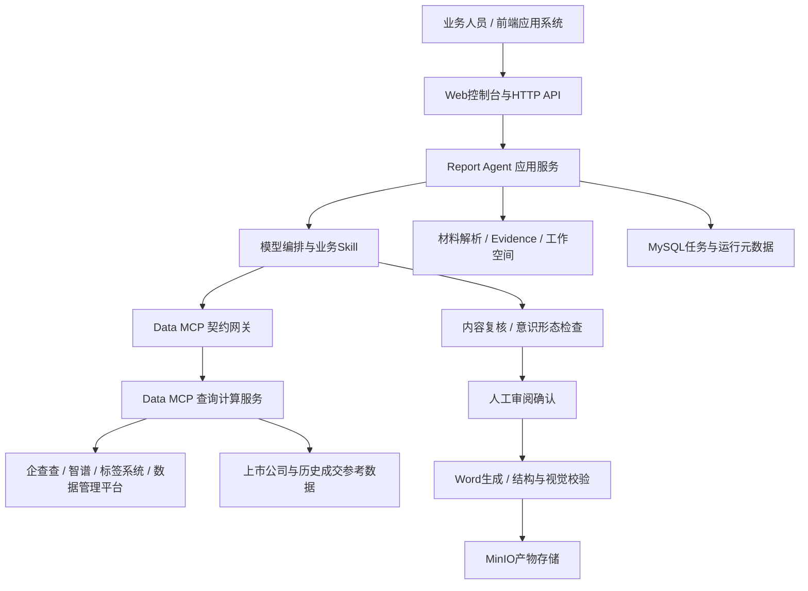

# 项目分析与投资人匹配报告、一页纸推介文档概要设计

版本：V1.0（评审稿）  日期：2026-11-05

## 1. 编制依据与范围

依据《北交所人工智能中台二期项目需求规格说明书》V12（2026-08-20），来源为用户提供的《投资人报告、一页纸bp.rtf》，以及本仓库当前工作区代码（Git HEAD：583756b）。本文面向研发、测试、业务与部署人员。

设计范围包括项目分析与投资人匹配报告、一页纸推介文档及其材料解析、数据补全、投资人筛选、估值、人工确认、审查、Word发布流程。不包含车类录入助审、产权/增资申请书录入和一句话找项目。需规中的“北交所”指北京产权交易所。

标记约定：“现有”表示已定位相关代码，不代表生产验收通过；“目标”表示应满足的设计；“待核验”表示尚无充分实现或运行证据。本文为静态分析成果，未运行外部依赖联调。原文后半部分章节编号混用3.4.2和3.5.3，按功能名称对应，避免误判为新增范围。

## 2. 建设目标与设计原则

系统将项目材料与工商、公开搜索、赛道标签、投资人、上市公司及历史成交数据融合，生成有来源依据、可人工修改的报告和一页纸Word材料。

1. 数据计算与文字生成分离：Data MCP负责事实查询、计算及候选匹配，Report Agent负责流程、证据、写作与交付。
2. 事实可追溯：材料、工具返回、人工修订分别记录来源；无直接依据的推断标记“AI推断”。
3. 不把缺失当零，不把部分成功当完整成功，不把模型生成文件名当已发布成果。
4. 人工确认作为显式流程节点；修改上游数据后使下游结果失效。
5. 一页纸优先复用同项目已确认成果，复用条件包含项目身份、材料版本及人工确认状态。

## 3. 总体架构

现有技术结构为Python服务、FastAPI API、Deep Agents编排、JSON Schema契约、MySQL元数据、工作空间文件及MinIO产物。代码包括Redis及检查点相关配置，但不能仅凭配置声明已具备分布式调度、高可用恢复能力。

Report Agent不得导入Data MCP源码或访问供应商原始状态；Data MCP不得读取Agent工作空间或生成报告。大结果以Evidence持久化，模型按需读取，避免一次塞入上下文。

## 4. 模块划分及代码对应

以下路径均相对仓库根目录。

| 模块 | 职责 | 主要代码位置 |
|---|---|---|
| 页面与API | 上传、任务查询、事件流、回答问题、取消、下载 | frontend/；apps/report_agent/src/report_agent/api/app.py |
| 运行管理 | task/session/run生命周期、后台执行、恢复 | application/runs.py、interactions.py、conversation_store.py |
| 材料理解 | 文件转换、OCR、正文与表格提取、材料证据 | infrastructure/materials/、application/materials.py |
| 编排 | 工具调用、上下文、预算、问题与检查点 | harness/、application/bootstrap.py |
| 报告业务 | 大纲、内容、引用与Word生成 | domain/report_content.py、application/reports.py、harness/investment_report_tools.py |
| 一页纸业务 | 业务类型、字段、模板、阶段执行 | domain/one_pager.py、application/one_pager_execution.py、harness/one_pager_checkpoint.py |
| 数据服务 | 工商、搜索、标签、投资人、可比估值 | apps/data_mcp/src/data_mcp/features/ |
| 质量与合规 | 内容检查、问题修正、规则审查 | application/review_checker.py、ideology_review.py |
| 交付 | DOCX、批注、渲染、发布 | infrastructure/word/、infrastructure/artifacts/minio.py |
| 持久化 | MySQL运行库、检查点、辅助任务 | infrastructure/persistence/、migrations/ |

未写完整前缀的Report Agent路径，统一位于apps/report_agent/src/report_agent/下。

## 5. 业务流程

### 5.1 投资人匹配报告

上传材料 → 解析与完整性判断 → 企业名称/业务类型确认 → 工商补全及冲突提示 → 多维搜索和清洗 → 搜索覆盖评估（最多补检一次） → 标签与画像 → 画像确认 → 内外部投资人匹配、剔除股东和去重 → 人工筛选确认 → 上市公司与历史项目估值 → 大纲与章节生成 → 内容复核 → 意识形态检查 → 人工审阅 → Word校验与发布。

最低材料条件不满足时停止生成，返回缺项；满足最低条件但信息不全时允许带缺失提示继续。最低条件清单需业务确认，建议至少包括可识别企业、明确业务类型及足以形成项目基础描述的材料，不能以文件上传成功作为通过条件。

工商信息与材料不一致时并列展示来源、字段与值，不静默覆盖；股权结构依需规以初始材料为准。明显异常数据转人工确认。

内部机构按匹配权重排序，网络机构最多展示10名；最终报告取已确认内部机构前20位、网络机构前10位。自然人仅输出数量。画像、名单和报告人工确认开关分别配置并留存当次策略。

### 5.2 一页纸

识别项目 → 查询可复用的解析和已确认投资人名单 → 缺少部分单独补齐 → 工商校验及搜索 → 公司简介 → 3组项目介绍 → 3组项目亮点 → 投资人结果 → 产权/增资模板填充 → 内容复核与意识形态检查 → 人工审阅 → 单页视觉校验 → Word发布。

目标字数：简介≤100字，介绍3条且每条80—150字，亮点3条且每条50—100字。一页纸内部候选展示前100名，最终内部20位、网络10位。是否将全部机构名称放入单页，以及版面不足时采用摘要还是附表，需模板评审决定，不得静默截断需求内容。

## 6. 数据与接口设计

### 6.1 数据分层

- MySQL：现有report_agent_tasks、report_agent_sessions、report_agent_runs、report_agent_artifacts保存任务、会话、运行及产物元数据；辅助机构工作簿使用独立迁移。
- 工作空间：材料、Evidence、写作Markdown、检查点及中间文档，按任务隔离。
- MinIO：可下载产物及对象元信息。以artifact_id、sha256及object_key定位版本，下载地址可过期。
- Data MCP数据域：上市公司、历史产权和历史增资数据独立治理，不与Agent运行库共享表结构。

目标补充项目稳定身份、材料版本、确认版本、规则版本和模板版本。当前DDL没有完整的业务确认版本模型，不应把task_id直接视为跨会话项目主键。

### 6.2 外部业务工具

接口事实源为contracts/mcp/*.json。主要工具为extract_project_profile、query_track_labels、match_investors、match_listed_peers、query_comparable_valuation；另有query_company_registry、search_company_web、query_cbex_listing_financials及export_matched_institutions契约。契约文件存在不等同于每种运行配置均已启用，发布前核对注册、Agent工具集合和环境配置。

统一返回schema_version、tool、status、summary、data、sources、warnings。status为success/partial/empty/failed；双方校验输入输出。partial保留可用事实并揭示缺项，empty展示无结果，failed展示错误且不得生成对应事实。破坏性修改须升级契约版本并同步两端发布。

### 6.3 页面API

现有接口包括POST /api/dev/runs、GET /api/runs/{run_id}、GET /api/runs/{run_id}/events、POST /api/runs/{run_id}/resume、POST /api/runs/{run_id}/cancel、GET /api/tasks/{task_id}/state及GET /api/artifacts/{artifact_id}/content。正式对接应发布独立接口清单，明确鉴权、参数、错误、幂等、事件重连与兼容策略；不能以开发接口命名推定已满足正式平台接入要求。

## 7. 估值与参考数据设计

上市公司：按年度处理年报和估值指标，统一代码、名称、年度、单位、标签、商业模式和行业分类；行业分类依需规半年更新。目标匹配所有符合赛道条件公司，剔除关键数据缺失或异常记录，保留剔除原因及样本量。

历史项目：产权与增资独立存储；依据已确认交易类型选择数据集，至少一个标签相同即入选，按标签交集数降序。产权缺收入、净利润、净资产/评估价值或成交金额即剔除；增资按需规校验审计收入、审计利润、净资产评估值和投资金额。

金额口径、股权比例、估值时点与指标适用性必须明确。以部分股权成交金额推算整体价值、增资前后估值口径均需业务审定，不得直接把成交金额当公司整体估值。按规模和受让方类型汇总PE/PB/PS区间、中位数、成交溢价率及评估增值率。计算由确定性程序执行，模型仅解释结果。

## 8. 非功能与部署设计

现有Compose主要编排Data MCP与Report Agent，模型、OCR、MySQL、Redis及MinIO按环境提供。test/uat/prod分离，数据库迁移显式执行，模板与契约随版本发布。

目标要求：网关认证与任务归属校验、下载授权、材料大小限制、URL下载访问控制、路径隔离、敏感日志脱敏、自然人信息最小化。加密路径前缀不能替代身份授权。材料内容视为待分析数据，不允许其改变工具权限或系统规则。

运行层设置工具超时、有限重试和模型预算；仅对可重试故障重试，业务empty不自动无限补查。取消后停止新增调用且不发布未完成产物。监控运行耗时、工具失败率、等待人工数、发布失败数、模型消耗和工作空间占用。

性能与可用性指标原需规未给定，本设计不虚构SLA。上线前按并发量、材料页数、OCR比例与模型时延压测并确定指标。当前asyncio后台任务不等于持久化队列，多实例恢复和进程崩溃恢复需专门验证。

## 9. 需求追踪、差距与实施优先级

| 需求 | 现有依据 | 差距/处理 |
|---|---|---|
| 文件解析与OCR | infrastructure/materials及解析测试 | 按PDF/doc/docx/ppt/pptx分别做实际样本验收 |
| 信息冲突确认 | registry-correction、business-type相关测试与交互模块 | 核验股权结构材料优先规则及最终导出一致性 |
| 搜索补检最多一次 | web_search与编排工具 | 待核验项目级计数，不以提示词代替硬限制 |
| 画像/名单人工开关 | 交互与checkpoint模块 | 分别核验报告和一页纸覆盖范围 |
| 投资人剔除股东 | match_investors契约 | shareholder_filter_applied=false时不得声称已排除 |
| 全量可比样本 | listed_peer_match及historical_valuation | 排名召回不等同全量筛选，须核验截断和口径 |
| 一页纸字数 | one-pager-fields.md | 当前介绍建议225—250、亮点170—185，与需规冲突；评审前以需规作为目标 |
| 一页纸版面和投资人列表 | 两套模板、one_pager_authoring | 核验全部字段与名单承载，单页需视觉验收 |
| 人工修改内容与排版 | 对话交互、Word生成 | 不据此宣称已有完整所见即所得编辑器 |
| 标签日更新/参考库年更新 | 标签、参考数据模块 | 调度、入库后台及更新审计需专项核验 |
| 发布与恢复 | runs.py后台task、resume、事件流 | README“仅同步”已滞后；跨进程可靠性仍需验证 |

P0：确认字数与模板、估值口径、名单规则、最低材料条件及人工确认开关；建立同一内容版本的检查与发布门禁。
P1：补齐复用版本管理、确认失效、全量估值验证、权限和可恢复运行。
P2：参考数据定期更新、可观测性、性能压测和运营管理。

## 10. 验收策略

采用需求—用例—产物追踪。覆盖产权与增资、独立一页纸与报告复用、材料不足、公司冲突、股东剔除失败、自然人计数、空估值、超长内容、人工修改后重审、取消恢复与过期下载。

现有tests/unit、Data MCP契约测试及frontend/tests提供基础。真实模型、OCR、工商、搜索、数据平台和MinIO须联调；Word需结构、来源批注及渲染共同验收。文档结构正确不代表一页纸没有溢出。只有生成并核验PublishedArtifact后，页面才能显示交付成功。
